# Créer un port de A à Z avec le générateur KJP

Ce guide accompagne la création d’un port sur **PC ou tablette en orientation paysage**, depuis une carte vide jusqu’au chargement du fichier dans le simulateur. Il est rédigé uniquement en français. Les actions « cliquer » se font par un toucher sur tablette, sauf lorsqu’un geste différent est précisé.

Ouvrez le [générateur de ports hébergé sur GitHub](https://arnaud2moissac.github.io/KJP_Port_Simulator/generateur-port.html). Les illustrations ont été réalisées sur cette version hébergée, le **16 octobre 2026**, avec **Port Tudy, à Groix**, comme localisation. Le générateur et les données OpenStreetMap peuvent évoluer : les nombres d’objets et certains libellés de vos résultats peuvent différer.

**Le résultat est un exercice de construction, pas une reproduction vérifiée de Port Tudy.** Six pontons de l’exemple proviennent de l’analyse OpenStreetMap. Les limites terrestres et les ouvrages ont été simplifiés à la main. Un ponton supplémentaire et ses catways servent à apprendre les outils ; leur présence ne décrit pas un aménagement réel du port. L’atelier sur les pendilles est facultatif et n’est pas conservé dans le fichier final. Les dimensions indiquées pour ces ajouts sont des valeurs d’exercice.

À la fin du parcours, vous disposerez d’un fichier `.kjp` réutilisable et modifiable. Le fichier réalisé pendant la rédaction est fourni dans le dépôt sous `docs/exemples/port-tudy-exercice.kjp`.

## 1. Préparer l’écran et reconnaître les commandes

**Objectif :** disposer d’une carte assez grande pour dessiner et retrouver les outils essentiels.

1. Ouvrez le générateur dans un navigateur récent. Sur tablette, tournez l’appareil en paysage.
2. Si un brouillon antérieur est restauré et que vous souhaitez le conserver, exportez-le avant de commencer un autre port.
3. Pour partir de zéro, cliquez sur **Nouveau port**, puis confirmez le remplacement du brouillon. Cette action ne fusionne pas deux ports.
4. Repérez la barre d’outils à gauche, la carte au centre, le panneau de localisation et le panneau de propriétés.
5. Repliez un panneau avec sa flèche lorsque vous avez besoin de place. Une flèche au bord de la carte permet de le rouvrir. Sur tablette, travaillez volontiers avec un seul panneau ouvert à la fois.

**PC :** utilisez la molette ou les boutons **+ / −** pour zoomer. Faites glisser une zone vide pour déplacer la carte. Dans l’outil Sélection, glisser un objet le déplace : commencez donc votre déplacement de carte sur une zone libre.

**Tablette :** touchez les outils et les objets. Utilisez les boutons **+ / −** lorsque vous voulez zoomer sans déplacer accidentellement un objet. Les gestes de zoom à deux doigts permettent aussi d’ajuster la vue. Faites défiler l’intérieur d’un panneau pour atteindre ses réglages du bas.

Une saisie numérique se valide en quittant le champ : **Tab** sur PC, ou un toucher dans un autre champ sur tablette. Vérifiez la valeur et la géométrie après validation.

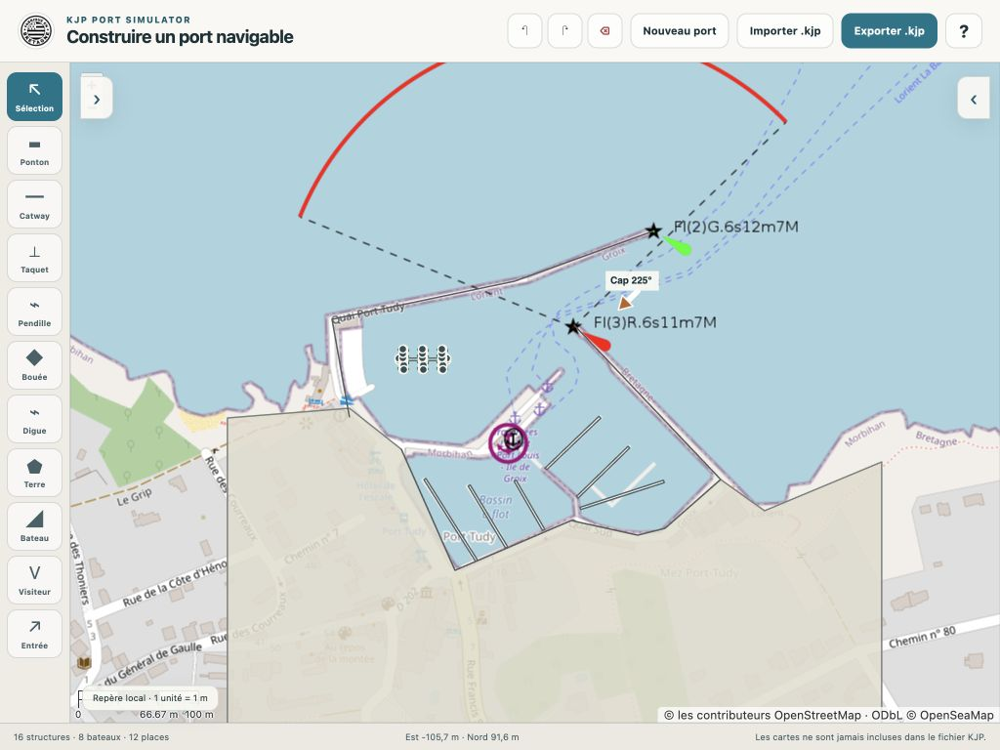

**À repérer sur l’image :** les flèches blanches aux deux bords de la carte rouvrent les panneaux ; les outils restent à gauche ; les commandes de fichier restent en haut. Dans la version actuelle, elles s’appellent **Ouvrir** et **Enregistrer**. Le compteur du bas distingue structures, bateaux et places. Les taquets ne sont pas additionnés au nombre de structures.

## 2. Localiser Port Tudy et choisir les fonds de carte

**Objectif :** afficher les bassins, les jetées et leurs abords avant de créer des objets.

1. Cliquez sur **Afficher les cartes en ligne**. Cette activation nécessite une connexion Internet.
2. Saisissez **Port Tudy, Groix** dans **Rechercher un lieu**, puis cliquez sur la loupe.
3. Attendez l’affichage du résultat et des tuiles cartographiques. Le texte renvoyé par la recherche permet de contrôler le lieu trouvé.
4. Ajustez le cadrage pour voir les deux jetées et l’ensemble des bassins.
5. Si nécessaire, saisissez un centre de vue dans **Latitude** et **Longitude**, puis cliquez sur **Centrer**. Pour le cadrage d’ensemble des captures : latitude **47,644200**, longitude **−3,446750**. Ce centre de travail n’est pas le point d’entrée du bateau, que vous placerez à l’étape 8.

**OpenStreetMap** donne les contours et les noms ; **OpenSeaMap** ajoute des indications et symboles maritimes. **Satellite** propose un fond IGN lorsque le service est disponible ; son curseur d’opacité aide à comparer l’image aux tracés. Désactivez un calque s’il masque les détails que vous cherchez à lire.

Utilisez aussi **Satellite** pour un premier repérage des pontons occupés, de la densité de bateaux et des équipements visibles. Vous referez cette comparaison après l’import, selon la méthode illustrée à l’étape 4, pour identifier ce qu’il reste à construire.

**Un fond cartographique ne crée aucun objet KJP.** Un quai, une bouée ou un bateau simplement dessiné sur le fond ne constitue pas encore un ouvrage, une bouée ou un bateau du simulateur. Il faudra l’importer ou le construire. Les cartes ne sont jamais incluses dans le fichier `.kjp`.

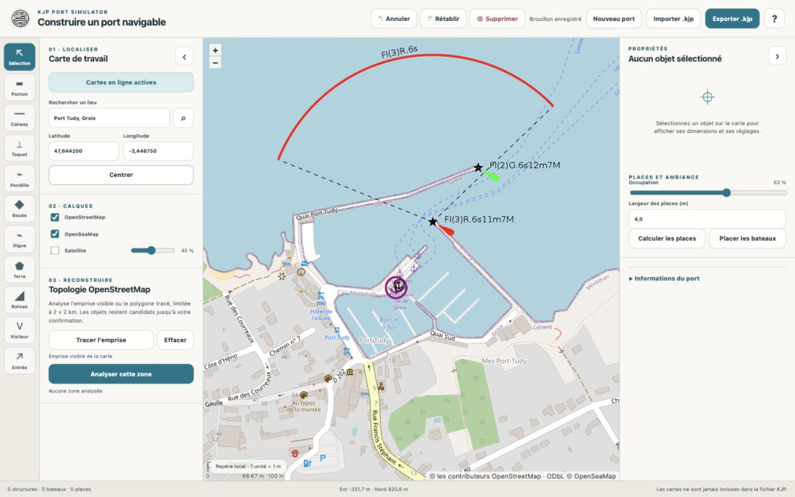

**Contrôle :** le port est reconnaissable, les deux jetées sont visibles et le compteur d’objets reste à zéro tant que vous n’avez rien intégré ou dessiné. Les crédits OpenStreetMap et OpenSeaMap sont visibles en bas de carte.

## 3. Délimiter et analyser une zone

**Objectif :** demander des propositions de géométrie à partir des objets OpenStreetMap.

Deux possibilités existent. Sans polygone, **Analyser cette zone** utilise l’emprise visible de la carte. Pour limiter la demande à un secteur précis, tracez un polygone.

1. Zoomez suffisamment : l’analyse est limitée à une emprise de **2 × 2 km au maximum**.
2. Cliquez sur **Tracer l’emprise**.
3. Posez les sommets autour du port, en incluant les ouvrages que vous souhaitez examiner. Gardez une marge autour des bassins et des extrémités de jetées.
4. Fermez le polygone en revenant sur son premier sommet. Un double-clic, ou un double toucher, peut également terminer le dessin. Contrôlez ensuite le cadrage et le message **Polygone actif**.
5. Cliquez sur **Analyser cette zone** et attendez la fin de la demande.

**Effacer** retire uniquement le polygone d’analyse. Il ne supprime pas les ouvrages du port. **Redessiner l’emprise** permet de préparer une autre zone.

Le bouton indique la tentative en cours et le serveur contacté. Le générateur peut essayer plusieurs serveurs et effectuer des reprises automatiques ; laissez-lui le temps de terminer, jusqu’à environ trois minutes, avant de conclure à un échec.

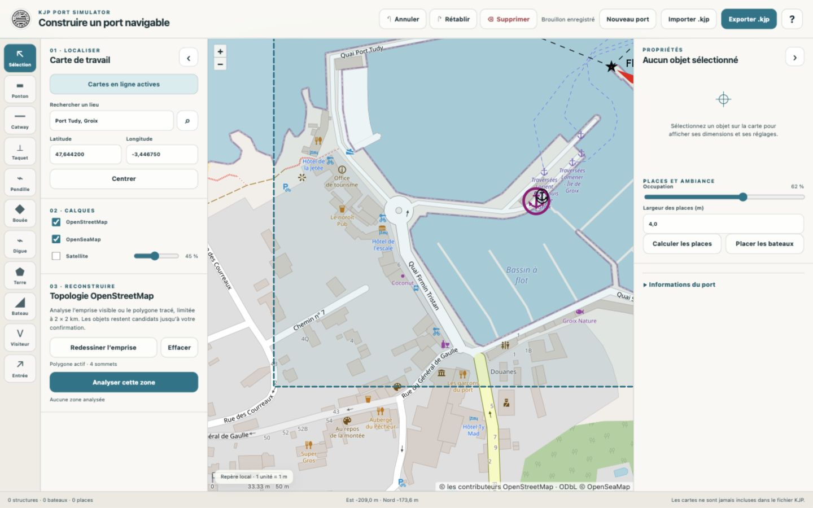

**Contrôle :** le contour de la zone est visible et le panneau indique son nombre de sommets. Après réception des données, un panneau de candidats apparaît à droite. Dans la session illustrée, une zone a fourni **11 candidats** ; ce nombre n’est pas une cible à reproduire.

**Le polygone sélectionne les objets à examiner ; il ne découpe pas nécessairement leur géométrie à sa frontière.** Un grand objet côtier ou terrestre peut déborder très loin de l’emprise et provoquer un fort dézoom lors de l’affichage des résultats. Recentrez la vue et examinez-le avant de le retenir.

## 4. Trier les candidats et contrôler les objets intégrés

**Objectif :** choisir ce qui doit devenir un objet du port.

1. Cliquez sur une ligne du panneau de candidats pour faire ressortir la proposition sur la carte.
2. Comparez sa forme et sa position au fond cartographique.
3. Vérifiez la catégorie du menu : **Ponton**, **Catway**, **Digue / quai**, **Terre non navigable**, **Bouée de navigation** ou **Ignorer**.
4. Cochez les propositions à conserver. Les boutons de catégorie sélectionnent ou désélectionnent tout un groupe ; **Tout désélectionner** permet de repartir d’une sélection vide.
5. Cliquez sur **Intégrer la sélection** une fois le tri terminé.

La confiance affichée est un indice de classification automatique. Elle ne certifie ni la nature de l’ouvrage, ni sa largeur, ni son niveau au-dessus de l’eau. Un objet très court n’est pas forcément un ponton utile ; un grand polygone terrestre ne doit pas être accepté uniquement parce qu’il recouvre une partie du port.

Dans l’exemple, **six grandes propositions de pontons** sont retenues. Les très petits éléments et les grands objets terrestres ne sont pas intégrés automatiquement. Les contours nécessaires seront complétés à la main.

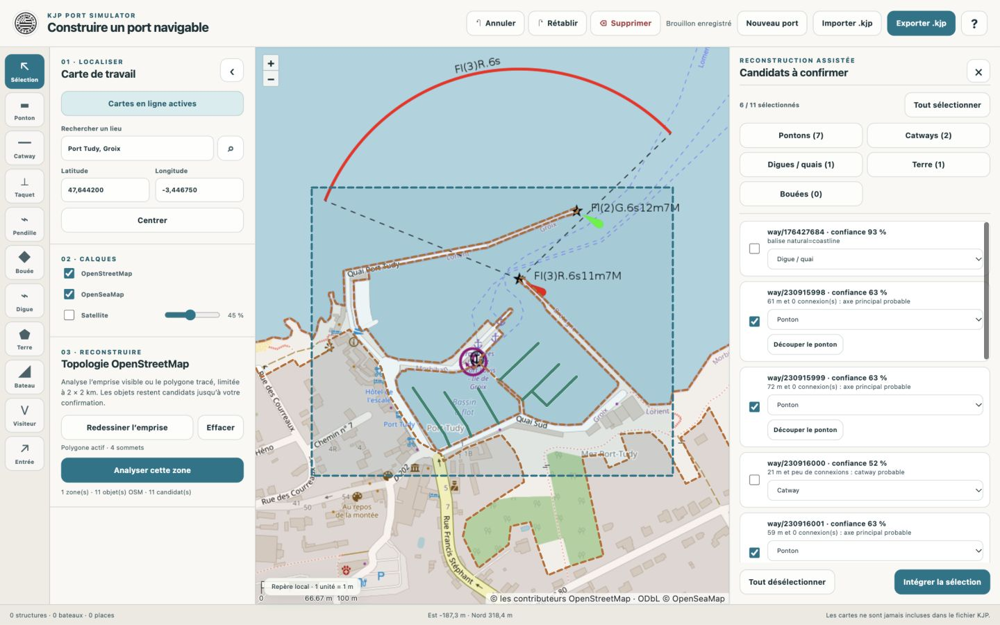

**Lecture de la capture :** la case décide de l’intégration ; le menu décide de la catégorie ; le compteur annonce la sélection en cours. Un tracé candidat encore visible sur la carte n’est pas nécessairement un objet conservé. Le compteur de structures, en bas, permet de vérifier ce qui a été effectivement intégré.

Si une proposition de ponton complexe présente **Découper le ponton**, examinez l’aperçu avant d’utiliser **Créer les objets**. **Annuler** dans cet aperçu abandonne la découpe. Cette opération n’est pas indispensable pour les six pontons retenus ici.

Revenez à **Sélection**, puis cliquez sur un ponton intégré. L’inspecteur affiche son identifiant, ses dimensions et ses réglages.

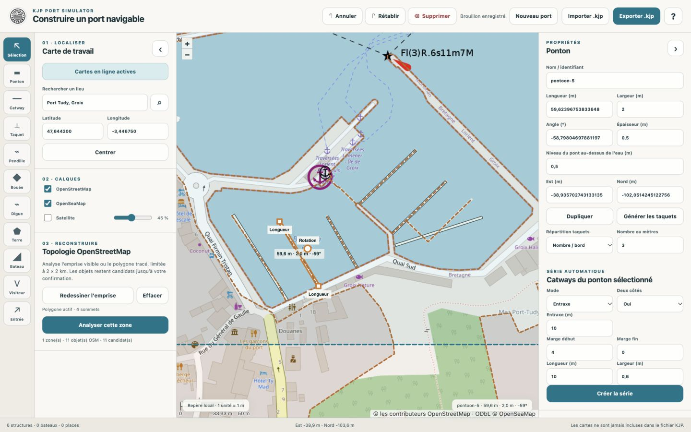

**PC et tablette :** les carrés de longueur permettent d’ajuster un ponton ; la poignée ronde de rotation permet de l’orienter. Pour un réglage précis, saisissez la dimension ou l’angle dans le panneau, puis quittez le champ. Les coordonnées **Est / Nord** déplacent l’objet dans le repère local du port : elles ne sont pas des latitudes et longitudes.

**Attention aux angles :** l’**Angle** d’un ponton est un angle géométrique, avec 0° vers l’est et 90° vers le nord. Le **Cap nautique** de l’entrée suit une autre convention, expliquée à l’étape 8.

**Contrôle :** l’objet sélectionné correspond bien à l’ouvrage visé. Corrigez les dimensions à partir d’informations fiables ; les valeurs proposées par l’import restent des approximations.

### Utiliser Satellite pour contrôler l’occupation et les équipements

L’analyse OpenStreetMap peut fournir les grands pontons sans tous leurs équipements. La vue satellite permet de comparer ces objets à une image du port et de préparer les compléments manuels.

1. Dans **Calques**, cochez **Satellite** et augmentez son opacité. La capture utilise **85 %**. Vous pouvez décocher **OpenSeaMap** si ses symboles gênent la lecture.
2. Zoomez sur les pontons du bassin intérieur. Pour retrouver le secteur illustré, centrez la vue sur **47,643650 / −3,446250**, puis zoomez davantage.
3. Comparez les tracés KJP superposés à l’image. Faites varier l’opacité pour distinguer le fond des objets créés et contrôler leur alignement.
4. Repérez les équipements à vérifier avant de compléter le port à l’étape 5 et de régler son occupation à l’étape 6.

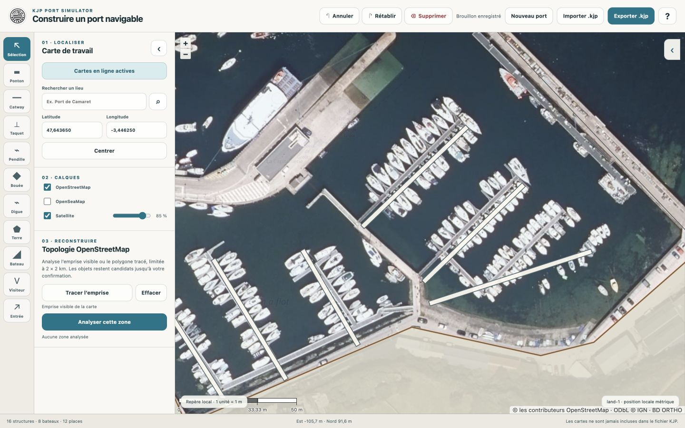

**À lire sur cette capture :** les bateaux blancs de la photographie sont nombreux des deux côtés des pontons. Les grands traits clairs superposés sont les objets KJP importés. Les bateaux photographiés ne sont pas des bateaux déjà ajoutés au modèle.

- **Pontons occupés :** regardez quels côtés accueillent des bateaux, les espaces laissés libres et les accès au bassin. Cela aide à choisir les secteurs à peupler dans votre port.
- **Densité de bateaux :** comparez les rangées serrées et les zones moins remplies pour préparer une ambiance cohérente. Réglez ensuite **Occupation** et contrôlez le résultat dans le générateur ; l’image ne remplit pas automatiquement les places.
- **Catways manquants :** cherchez les petites avancées perpendiculaires aux pontons, parfois masquées par les bateaux. Si un catway visible et confirmé manque dans les objets KJP, ajoutez-le manuellement ou créez une série adaptée. L’espacement des bateaux, à lui seul, ne prouve pas la présence de catways.
- **Corps-morts et bouées d’amarrage :** repérez les bouées et les groupes de bateaux mouillés à l’écart des pontons. Ils peuvent signaler une zone de corps-morts absente de l’import. Vérifiez le type et la position des équipements avant de les ajouter avec **Bouée** ; le bloc immergé et ses lignes ne sont pas nécessairement visibles sur la photo.

La photographie montre l’occupation **au moment de la prise de vue**, pas la disponibilité actuelle des places. Utilisez-la pour guider la construction et repérer les manques, puis confirmez les détails incertains avec un plan du port ou un relevé. L’exercice conserve ici ses pontons simplifiés et son ponton pédagogique ; cette image ne certifie pas une reproduction complète de Port Tudy.

## 5. Compléter le port : terre, ouvrages, ponton et catways

**Objectif :** construire ce que l’analyse n’a pas fourni et apprendre les outils manuels.

### Dessiner la terre et les ouvrages

1. Choisissez **Digue** pour tracer un obstacle linéaire le long d’un ouvrage. Posez les points dans leur ordre et terminez par un double-clic, ou un double toucher.
2. Revenez à la vue d’ensemble si le cadrage a changé à la fin du dessin. Vérifiez immédiatement que le tracé suit le bon ouvrage.
3. Choisissez **Terre** pour une surface non navigable. Suivez son contour avec plusieurs sommets et fermez le polygone sur le premier sommet. Évitez de couper à travers le bassin.
4. Utilisez **Sélection** pour examiner le résultat. Si le contour est incorrect, annulez immédiatement ou supprimez l’objet avant de le redessiner.
5. Zoomez sur chaque **raccord entre une digue et la terre**. Lorsque l’ouvrage rejoint le rivage, prolongez son pied légèrement dans la surface terrestre : aucun filet d’eau ne doit créer un passage fictif entre les deux. Préservez l’ouverture réelle entre les jetées.

Une terre est une surface fermée ; une digue est un ouvrage linéaire doté d’une largeur et d’une hauteur. Les grands champs grisés de l’inspecteur ne permettent pas de remodeler tous les sommets : ne cherchez pas à corriger un contour en lui donnant simplement une autre longueur. Certains objets peuvent se déplacer globalement par glissement.

Un quai reconnu comme tel à l’import conserve ses possibilités propres. Un obstacle tracé avec **Digue** ne devient pas automatiquement un quai pouvant recevoir tous les réglages d’amarrage.

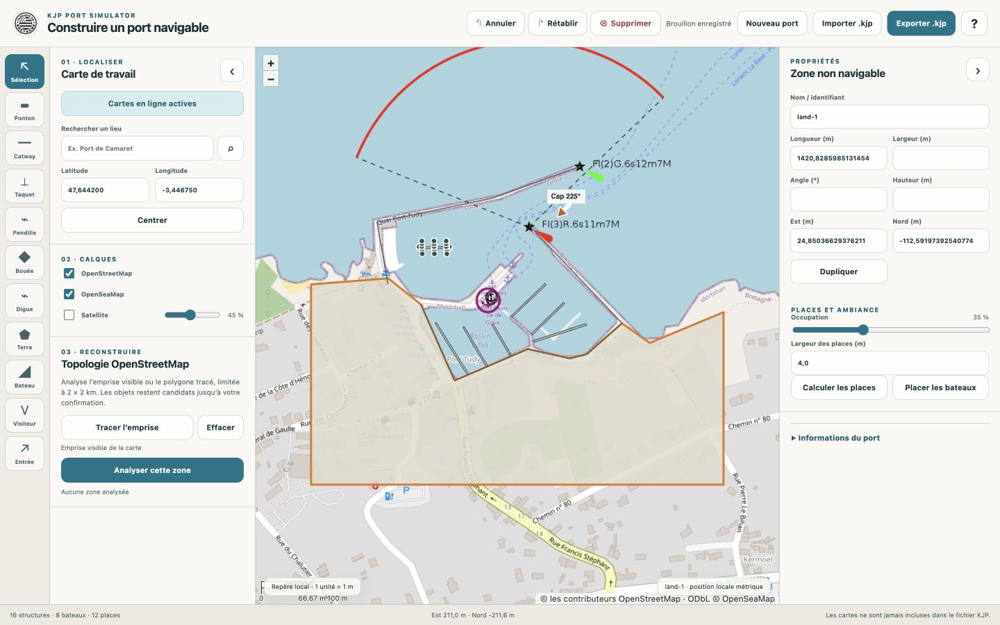

**Dans cette illustration :** le pied de la digue nord, à gauche de l’entrée, rejoint la terre sans ouverture. Ce raccord est également fermé dans le fichier d’exercice et contrôlé dans le simulateur à l’étape 11. La surface terrestre et les deux ouvrages restent des tracés pédagogiques simplifiés ; leurs limites et leurs hauteurs ne sont pas des mesures réelles de Port Tudy.

### Mesurer une distance sur la carte

Choisissez **Mesurer**, puis cliquez sur deux points de la carte, y compris sur le fond satellite. La distance en mètres apparaît pendant le tracé et reste visible après le second clic. Pour relever un entraxe, pointez le même repère sur deux catways voisins, par exemple leur axe.

Avec un ponton sélectionné, **Utiliser comme entraxe** reporte la mesure arrondie au dixième de mètre dans les réglages de série. Vérifiez les autres paramètres avant de créer la série. **Effacer** retire la mesure ; **Échap** annule un tracé en cours. La mesure n’est pas incluse dans le fichier KJP.

### Ajouter un ponton et ses taquets

Le ponton de cette partie est **un ajout d’exercice**, dans une zone d’eau libre ; ne le confondez pas avec l’un des six pontons importés.

1. Choisissez **Ponton**, puis cliquez successivement sur ses deux extrémités. La longueur et l’orientation suivent les points choisis.
2. Dans ses propriétés, réglez **Longueur : 40 m**, **Largeur : 2 m**, **Angle : 0°**. Validez chaque modification en quittant le champ.
3. Pour le déplacer, glissez son corps ; pour ajuster sa longueur et son orientation, glissez une extrémité dans la direction souhaitée, l’autre restant fixe. Vérifiez que le ponton ne recoupe ni une terre, ni un ouvrage, ni un autre ponton.
4. Choisissez **Répartition taquets : Nombre / bord**, indiquez **3**, puis cliquez sur **Générer les taquets**. Cela donne ici six taquets sur le ponton.
5. Si vous avez ensuite modifié fortement sa longueur, régénérez les taquets et contrôlez leurs positions.

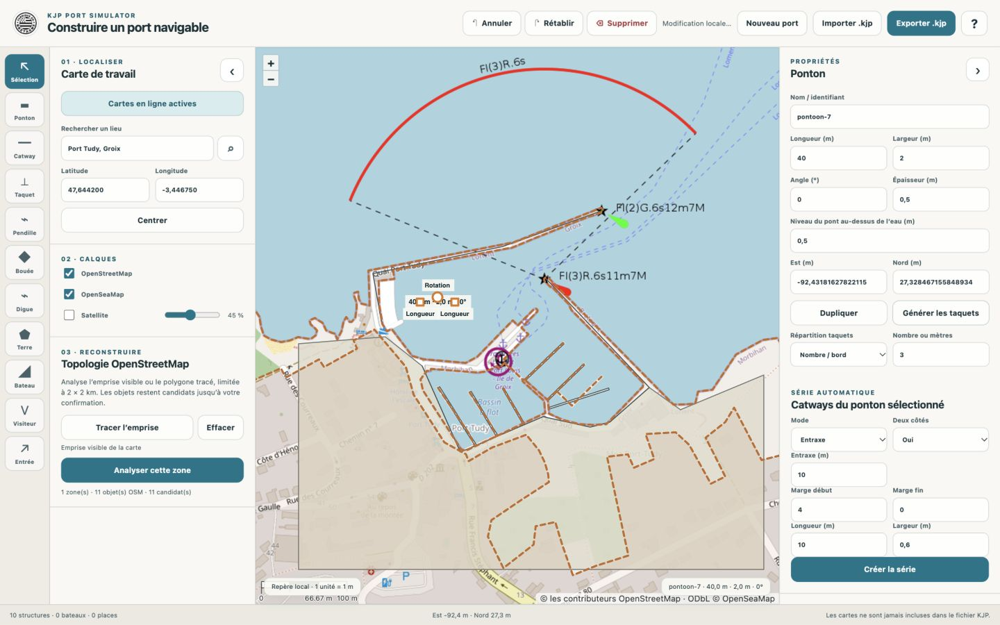

**Pour ajouter un taquet isolé :** sélectionnez d’abord le ponton, le catway ou un quai compatible, choisissez **Taquet**, puis cliquez sur le bord souhaité. Un taquet est lié à son ouvrage parent ; il ne se place pas simplement au milieu de l’eau.

Les champs **Épaisseur** et **Niveau du pont au-dessus de l’eau** décrivent l’ouvrage, pas la profondeur du bassin. Conservez des valeurs cohérentes avec vos sources ; les valeurs d’exercice ne constituent pas un relevé.

### Créer une série de catways

1. Sélectionnez le ponton de 40 m.
2. Dans **Catways du ponton sélectionné**, choisissez **Mode : Nombre** et **Deux côtés : Oui**.
3. Indiquez **Nombre : 3**, **Marge début : 4 m**, **Marge fin : 4 m**, **Longueur : 8 m**, **Largeur : 0,6 m**.
4. Cliquez une seule fois sur **Créer la série**.
5. Vérifiez les six catways : le nombre saisi correspond ici à **trois par côté**. Le générateur ajoute aussi leurs taquets.

Le mode **Entraxe** sert à choisir un espacement entre les axes à la place d’un nombre. Contrôlez toujours le résultat sur la carte, notamment les marges et la place laissée aux bateaux.

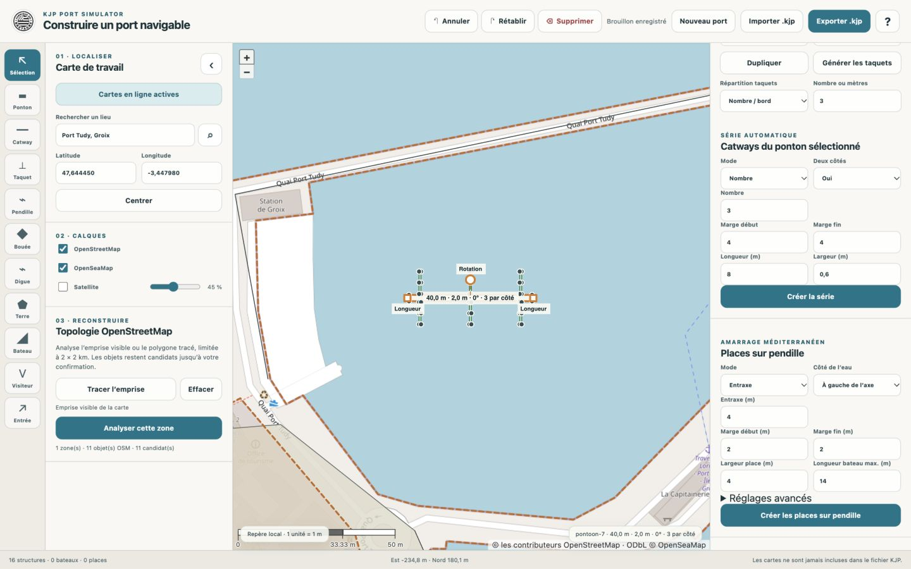

Un catway appartenant à une série ne se règle pas librement comme un objet indépendant. **Détacher ce catway** permet de le modifier seul. **Modifier la série** applique les réglages courants du générateur à sa série : préparez les valeurs dans le bloc du ponton parent, puis sélectionnez un catway de cette série et appliquez-les. N’utilisez pas **Créer la série** une seconde fois pour remplacer une série existante : vous risqueriez d’en superposer deux.

Pour un seul catway, l’outil **Catway** permet un ajout manuel près d’un ponton ; vérifiez son rattachement et son orientation. Pour retirer un objet, sélectionnez-le puis utilisez **Supprimer**. Les boutons **Annuler / Rétablir** permettent de revenir sur les modifications tant que vous restez dans la session d’édition.

**Bouées :** l’outil **Bouée** ajoute un objet KJP. Réglez ensuite son type OpenSeaMap, sa catégorie et sa forme ; un corps mort possède des réglages différents d’une bouée de navigation. La présence d’un symbole sur le calque OpenSeaMap ne suffit pas à créer cet objet. N’ajoutez un balisage réel que si vous en avez vérifié la source.

## 6. Calculer les places, réserver les visiteurs et placer les bateaux

**Objectif :** transformer les catways en places utilisables et préparer le décor.

1. Dans **Places et ambiance**, indiquez une **Largeur des places de 4 m** pour l’exercice.
2. Cliquez sur **Calculer les places**. La série de six catways de cet exemple produit **12 places** avant d’autres aménagements.
3. Sélectionnez une place libre sur la carte, en cliquant à l’intérieur de son rectangle plutôt que sur un taquet ou un catway voisin.
4. Cochez **Place visiteurs** et renseignez **Nom de la place**, par exemple **Visiteurs du guide**.
5. Réglez **Occupation**, puis cliquez sur **Placer les bateaux**. Le calcul de remplissage évite les places marquées visiteurs. Si vous les avez désignées après un premier remplissage, vérifiez qu’elles sont effectivement libres et refaites le peuplement si nécessaire.

L’occupation est une consigne de remplissage, pas la garantie d’un nombre exact de bateaux. Les captures ont été obtenues avec **35 %**, et le résultat de cette session est **8 bateaux**. Ne cherchez pas à retrouver ce nombre à tout prix.

Pour votre propre port, revenez à la comparaison satellite de l’étape 4 : elle aide à choisir la densité et les secteurs occupés que vous souhaitez représenter. Les **35 %** de cet exercice concernent le peuplement pédagogique ; ils ne mesurent pas le taux d’occupation réel de Port Tudy. Après remplissage, vérifiez les accès et les espaces entre les bateaux dans le modèle.

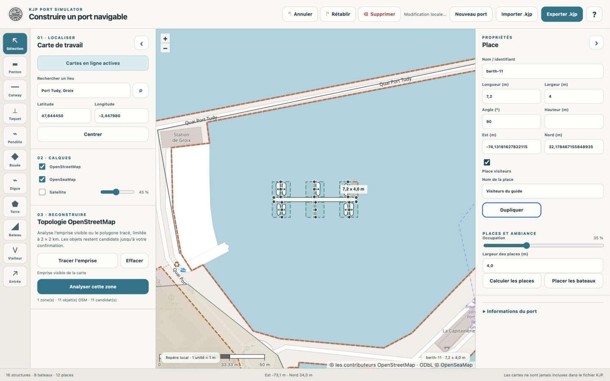

**Contrôle :** le titre de l’inspecteur doit être **Place**, et non **Taquet**, **Catway** ou **Bateau**. Zoomez si les objets sont trop proches. La place visiteurs doit rester reconnaissable et accessible.

**Placer les bateaux** régénère le peuplement ; ce n’est pas un bouton qui ajoute uniquement un bateau supplémentaire. L’outil **Bateau** permet un ajout individuel sur une place existante, si elle est disponible. L’outil **Visiteur** crée une place près d’un catway ; pour marquer une place déjà calculée, utilisez plutôt sa case **Place visiteurs**.

Le calcul automatique des places concerne les catways. Finalisez-le avant l’atelier pendilles : un nouveau **Calculer les places** reconstruit cette liste et peut retirer des places créées autrement. Après une modification des catways ou des places, contrôlez à nouveau les bateaux et les accès.

## 7. Atelier facultatif : comprendre les places sur pendille

**Cet atelier illustre une fonction du générateur. Il ne décrit pas les équipements réels de Port Tudy.** Vous pouvez le passer et poursuivre directement avec l’entrée. Pour le réaliser séparément, revenez ici après avoir exporté une première version de votre port à l’étape 10.

1. Sélectionnez un ponton libre, ou un quai compatible. Pour la capture, un second ponton d’exercice de **20 m**, distinct de celui à catways, a été ajouté.
2. Dans **Places sur pendille**, choisissez **Mode : Nombre**, **Nombre : 3**, et le **Côté de l’eau** qui correspond à la zone libre devant l’ouvrage.
3. Pour retrouver la démonstration : marges de **2 m** au début et à la fin, largeur de place **4 m**, longueur maximale de bateau **12 m**.
4. Ouvrez **Réglages avancés**. Les valeurs de démonstration sont une distance de corps-mort de **18 m** et une profondeur de **3 m**. Elles sont arbitraires et ne constituent pas des données sur le fond du port.
5. Cliquez sur **Créer les places sur pendille**. Le générateur crée les places, les pendilles, les taquets associés et des bateaux pour cette série.
6. Vérifiez que tout se trouve du côté de l’eau et ne recoupe pas un autre aménagement.

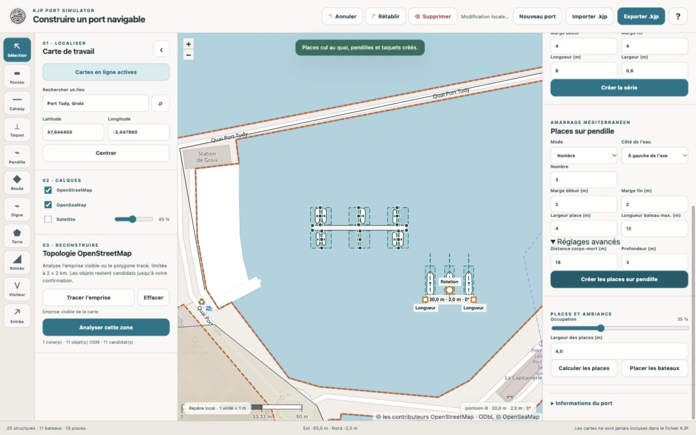

Pour une pendille seule, sélectionnez d’abord un ponton ou un quai compatible, choisissez **Pendille**, puis cliquez dans l’eau à l’emplacement du corps-mort. La pendille sélectionnée permet de régler sa distance, sa profondeur et sa longueur disponible. **Détacher de la série** rend son réglage indépendant.

Dans le fichier accompagnant ce guide, cet atelier a été annulé avant de continuer : il n’y a **aucune pendille** dans le port final. Si vous souhaitez le retirer de votre exercice, utilisez Annuler jusqu’à retrouver l’état voulu, ou réimportez votre sauvegarde antérieure. Évitez de recalculer toutes les places pour tenter d’effacer uniquement cet atelier.

## 8. Placer et orienter l’entrée du bateau

**Objectif :** définir un point de départ dégagé et une direction d’arrivée lisible dans le simulateur.

1. Revenez à une vue suffisamment large pour voir les jetées et leur ouverture.
2. Choisissez **Entrée**.
3. **PC :** appuyez à l’emplacement du départ, gardez le bouton enfoncé, glissez dans la direction voulue et relâchez.
4. **Tablette :** posez le doigt au départ, maintenez le contact, glissez dans la direction voulue et relevez le doigt.
5. Sélectionnez l’entrée et affinez si nécessaire son **Cap nautique** dans les propriétés. Quittez le champ pour valider.

Le premier point fixe la position ; le glissement fixe l’orientation. Il n’est pas nécessaire de tracer une grande flèche : la longueur du dessin affiché ne représente pas une distance de parcours à imposer au bateau.

Le cap nautique vaut **0° au nord**, **90° à l’est**, **180° au sud**, **270° à l’ouest**. Dans l’exercice, l’entrée est placée entre les jetées et orientée à **225°**, vers l’intérieur du bassin. C’est le réglage du scénario illustré, pas une instruction d’entrée dans le port réel.

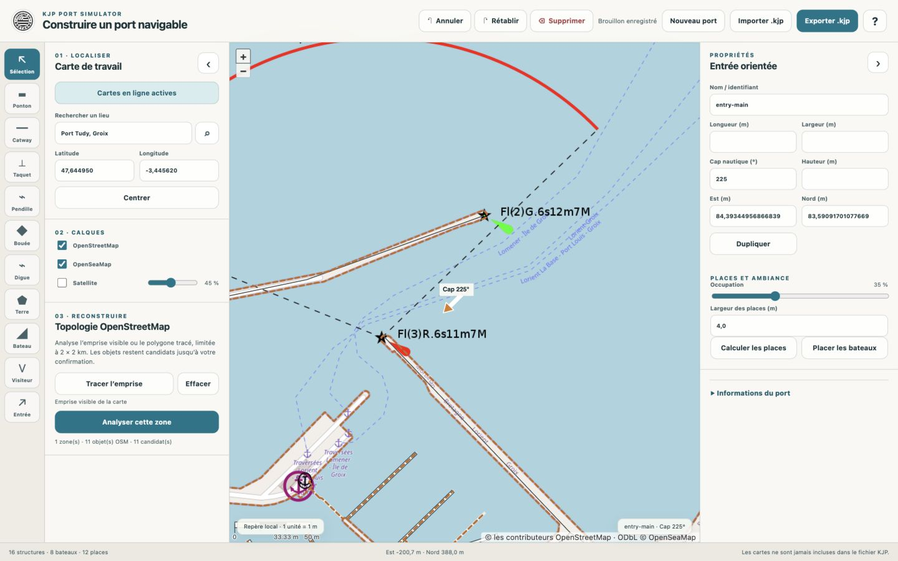

**Contrôle :** prévoyez de la place pour l’ensemble du bateau, pas seulement pour le point de la flèche. Le départ doit rester dans l’eau, à distance des ouvrages et des bateaux statiques. Le fichier KJP attend une entrée unique ; utiliser de nouveau l’outil Entrée permet de la replacer.

## 9. Renseigner les informations du port

**Objectif :** rendre le fichier compréhensible pour la personne qui l’utilisera.

1. Ouvrez **Informations du port**, en bas du panneau de droite.
2. Renseignez au minimum **Nom du port**. Pour l’exercice : **Port Tudy – exercice du guide**.
3. Indiquez l’**Auteur** et la **Source**. Dans une création réelle, utilisez votre nom ou un nom de contribution explicite, puis indiquez les sources effectivement employées.
4. Complétez, si vous disposez d’informations vérifiées, l’URL de capitainerie, les horaires, les préconisations de courant et le commentaire.
5. Distinguez dans le commentaire les données importées, les approximations et les ajouts pédagogiques. Quittez le dernier champ pour valider sa saisie.

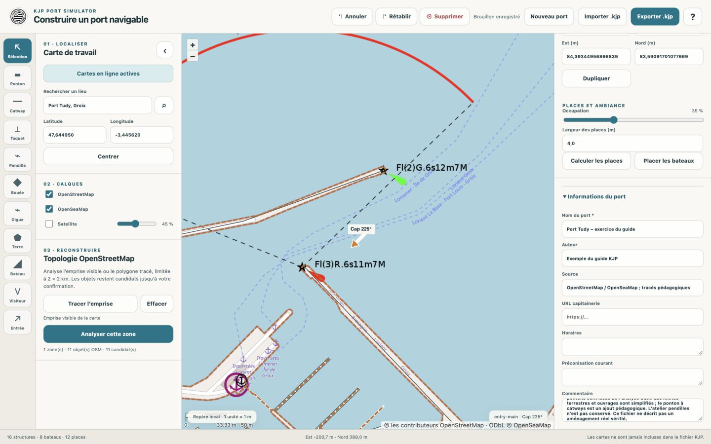

**Pour cet exemple :** les champs horaires, capitainerie et courant ont été laissés vides plutôt que d’inventer des informations locales. Le commentaire signale les contours simplifiés et le ponton supplémentaire. Les textes saisis font partie du port ; ils ne sont pas retraduits automatiquement par le sélecteur de langue.

## 10. Enregistrer, importer et exporter

**Objectif :** disposer d’une sauvegarde indépendante du navigateur et vérifier qu’elle peut être reprise.

Le **brouillon local** est enregistré automatiquement lorsque le navigateur autorise le stockage. Le message **Brouillon enregistré** confirme cet enregistrement local. Il ne remplace pas un fichier conservé dans vos documents : la suppression des données du site ou un autre appareil ne vous donne pas accès à ce brouillon.

1. Cliquez sur **Enregistrer**, puis sur **Télécharger le fichier .kjp** dans la section **Sur cet appareil**.
2. Attendez le téléchargement et le message **Fichier KJP validé et exporté**.
3. Vérifiez où le navigateur a enregistré le fichier. Sur tablette, retrouvez-le dans le gestionnaire de téléchargements ou l’application Fichiers.
4. Conservez des versions avec des noms distincts avant les changements importants, par exemple `port-tudy-01.kjp`, puis `port-tudy-02.kjp`.
5. Pour reprendre un fichier, cliquez sur **Ouvrir**, puis **Choisir un fichier .kjp**, choisissez-le et vérifiez le nom du port ainsi que les objets de la carte.

La section **Bibliothèque publique · Communauté** permet aussi d’ouvrir un port
stocké sur pCloud. Vous pouvez y publier depuis le générateur ouvert en local ou hébergé :
choisissez **Enregistrer**, puis **Enregistrer dans la bibliothèque**, sans compte
ni connexion pCloud. Si le port existe déjà, confirmez la publication d’une mise
à jour ou annulez. La bibliothèque affiche la version la plus récente ; pCloud
conserve les anciens dépôts. Le port est accompagné de son catalogue et le
simulateur l’affiche avec la source **Communauté**. Les ports **KJP** du dépôt
restent dans une bibliothèque éditeur séparée, inaccessible depuis le générateur.

L’import charge un document de travail ; il ne l’ajoute pas au port déjà ouvert. L’historique Annuler / Rétablir de la session précédente n’est pas reconstitué. Exportez les modifications que vous voulez garder avant de charger un autre fichier.

Si l’export est refusé, lisez le message : il indique le champ ou l’objet à corriger. Lorsque **Afficher l’objet** est proposé, ce bouton sélectionne l’élément concerné. Corrigez-le, puis relancez l’export.

**Contrôle effectué pour ce guide :** le fichier exporté a été réimporté dans le générateur hébergé. Il contient sept pontons, six catways, deux obstacles linéaires, une terre, 42 taquets, 12 places, huit bateaux statiques et une entrée. Le compteur affiche **16 structures · 8 bateaux · 12 places**. Le chiffre de sept pontons comprend les six importés et le ponton d’exercice ; les bateaux statiques sont le décor du port, pas le bateau que vous piloterez.

## 11. Vérifier le port dans le simulateur

**Objectif :** contrôler le résultat dans le produit qui utilisera le fichier.

1. Ouvrez le [simulateur KJP hébergé sur GitHub](https://arnaud2moissac.github.io/KJP_Port_Simulator/simulateur-port.html).
2. Dans le panneau **Port actif**, cliquez sur le bouton **Charger un port KJP** et choisissez votre fichier `.kjp`.
3. Vérifiez le nom du port chargé et la situation **Navigation libre · point d’entrée**.
4. Mettez la simulation en pause pour inspecter la scène. Passez en vue **Dessus** et dézoomez pour voir les ouvrages. Le bouton de recentrage ramène la vue sur le bateau.
5. Vérifiez la position et le cap du bateau, les limites terrestres, les passages entre ouvrages, les catways et les bateaux statiques.
6. Dans la liste des places visiteurs, choisissez la place nommée pour la surligner et contrôler sa présence. Le cadrage se déplace vers cette place.
7. Reprenez la simulation pour un premier parcours prudent, sans vent ni courant, puis corrigez dans le générateur tout problème de construction observé. Réexportez et rechargez le fichier corrigé.

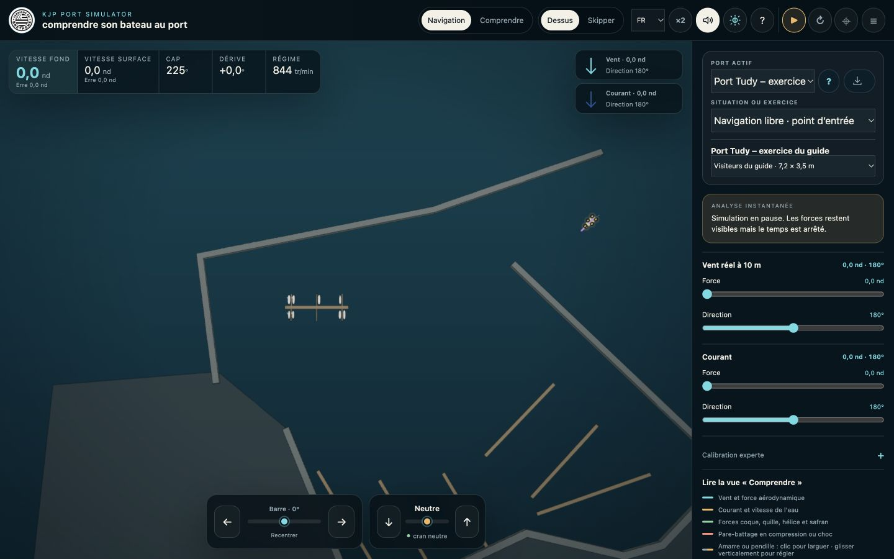

**Lecture de la capture :** le port actif porte le nom de l’exercice ; le cap de départ est 225° ; la place **Visiteurs du guide** figure dans la liste. Les fonds OpenStreetMap et OpenSeaMap du générateur ne sont pas reproduits dans le simulateur : seuls les objets du fichier constituent le port.

Le chargement réussi confirme que le fichier peut être utilisé. Il ne remplace pas votre contrôle visuel et pratique : une terre mal tracée, une passe trop étroite ou un bateau mal placé nécessitent un retour à l’éditeur.

## Dépanner sans perdre son travail

**La recherche ne trouve pas Port Tudy.** Vérifiez la connexion et essayez la requête complète `Port Tudy, Groix`. Les champs Latitude / Longitude et le bouton Centrer permettent de retrouver une zone sans la recherche de nom.

**L’analyse demande de zoomer davantage.** Réduisez l’emprise visible ou tracez un polygone plus petit. Le plus grand côté de la zone ne doit pas dépasser 2 km.

**Les serveurs sont occupés.** Attendez les reprises annoncées. Si l’analyse finit en échec, le travail déjà construit n’est pas supprimé ; réessayez plus tard ou continuez les tracés manuels à partir d’un fond disponible.

**La carte s’éloigne après l’analyse.** Une géométrie OSM peut être bien plus grande que la zone choisie. Recentrez, examinez cette proposition et ne l’intégrez pas si elle ne convient pas.

**Le cadrage change en terminant un dessin.** Contrôlez le résultat, puis recentrez ou ajustez le zoom avant le tracé suivant. Pour un polygone, fermer sur le premier sommet évite un double-clic supplémentaire sur la carte.

**Un objet visible sur la carte n’existe pas dans le simulateur.** Il peut appartenir au fond cartographique, ou n’être qu’un candidat non intégré. Vérifiez le compteur et sa sélection avec l’outil Sélection.

**Je sélectionne un taquet au lieu d’une place.** Zoomez et visez l’intérieur du rectangle de la place, loin des points et des bords. Vérifiez le titre de l’inspecteur avant de modifier un réglage.

**Un catway refuse une modification individuelle.** Il appartient probablement à une série. Utilisez les réglages de série ou Détacher ce catway, selon le résultat souhaité.

**Je ne trouve plus un réglage sur tablette.** Repliez le panneau opposé, rouvrez le panneau de propriétés avec sa flèche, puis faites défiler son contenu. Les réglages d’occupation et les informations du port peuvent se trouver plus bas.

**L’import ou l’export est refusé.** Lisez le premier diagnostic, vérifiez le nom du port, l’entrée et l’objet signalé. Un fichier renommé en `.kjp` sans être un document KJP valide n’est pas importable. Ne supprimez pas votre dernier fichier fonctionnel pendant la correction.

**Le brouillon n’est plus disponible.** Réimportez votre dernier `.kjp`. Après réouverture, il peut aussi être nécessaire de réactiver les cartes en ligne ; le port et les fonds cartographiques n’ont pas le même rôle.

## Mémo avant de partager un port

- Les ouvrages et les terres suivent des contours contrôlés ; leurs raccords ne laissent aucun passage fictif et les ouvertures réelles restent dégagées.
- Les classifications et dimensions importées ont été vérifiées ; les approximations sont expliquées.
- La comparaison satellite a servi à vérifier les pontons occupés, la densité de bateaux et les éventuels catways ou mouillages manquants ; les détails incertains ont été confirmés avant ajout.
- Les séries ne sont pas superposées et leurs taquets sont correctement placés.
- Les places visiteurs sont nommées, disponibles et accessibles.
- L’entrée est unique, dégagée et orientée dans le sens du départ souhaité.
- Le nom, l’auteur et les sources sont renseignés ; les conseils locaux ne sont ajoutés que s’ils sont vérifiés.
- Le fichier `.kjp` a été exporté, réimporté dans le générateur et chargé dans le simulateur.
- Une sauvegarde précédente est conservée avant la prochaine modification importante.

## Illustrations, sources et versions

Les captures de ce guide proviennent exclusivement des applications KJP hébergées sur GitHub : le générateur pour les étapes d’édition et le simulateur pour le contrôle final. Les vues ordinateur ont été prises en paysage, principalement en 1440 × 900 ; la vue tablette utilise 1024 × 768. Elles montrent une interface réellement manipulée, avec des légendes décrivant les points à vérifier.

Les fonds des captures portent les attributions **© les contributeurs OpenStreetMap · ODbL** et, selon les calques actifs, **© OpenSeaMap** ou **© IGN · BD ORTHO**, conservées au bas des images. La vue dite Satellite utilise ici l’orthophotographie IGN ; son occupation est celle de la prise de vue. La carte peut être consultée sur [OpenStreetMap autour de Port Tudy](https://www.openstreetmap.org/#map=17/47.6442/-3.44675). Les géométries importées conservent leurs sources dans le fichier KJP. Les images des cartes ne sont pas embarquées dans ce fichier.

**Versions de la release 2.1 :** générateur 1.1.0, schéma KJP 3. Projet de Arnaud de Moissac, distribué sous licence Apache 2.0. Contact : kjp.bzh@gmail.com.

[Présentation complète du projet](https://github.com/arnaud2moissac/KJP_Port_Simulator/blob/main/README.md) · [Licence Apache 2.0 du projet KJP](https://github.com/arnaud2moissac/KJP_Port_Simulator/blob/main/LICENSE)
