# Générateur de ports KJP — audit UX/UI et proposition de refonte

**17 octobre 2026 · Évaluation experte · Ordinateur et tablette paysage**

## 1. Le diagnostic et la décision recommandée

Le générateur possède déjà les fonctions d’un véritable outil de création. Son interface les expose principalement comme une collection de commandes et de formulaires. L’utilisateur doit encore construire lui-même le parcours, comprendre les dépendances entre objets et se souvenir des conséquences de chaque bouton.

L’impression de prototype vient surtout de cette organisation : une carte comprimée entre deux panneaux, une typographie très petite, des symboles hétérogènes, des formulaires longs, des identifiants techniques et des actions dont la portée devient claire après lecture du guide. La couleur et les arrondis sont déjà cohérents ; les changer seuls aurait un effet limité.

**Je recommande de faire évoluer KJP vers un atelier cartographique : la carte au centre, un seul panneau de travail à la fois, quatre étapes librement accessibles et des actions qui annoncent leur résultat.** Le parcours proposé est **Localiser → Construire → Préparer → Vérifier**. Il guide les nouveaux contributeurs et laisse les utilisateurs réguliers accéder directement à leurs outils.

Le premier investissement devrait porter sur trois ensembles : **l’espace et la lisibilité**, **la maîtrise des opérations de génération**, **la correction et la sauvegarde**. Ils amélioreront à la fois la perception de qualité et le confort réel d’utilisation.

## 2. Périmètre, méthode et niveau de preuve

L’audit suit la route `ui-check`. Il porte sur le générateur ; aucune modification du produit ni de sa physique n’est proposée dans ce changement. Le guide français a été lu intégralement. L’application locale a été manipulée, puis ses sources appelantes ont été consultées pour préciser certains comportements.

**État examiné :** dépôt `/Users/arnaud/Codex_main/KJP_Port_Simulator`, branche `main`, HEAD `5c9dbfc7a9647d2af10d91af761882293894ddab`. Le dépôt comportait déjà des modifications, notamment dans le générateur, sa localisation et le guide. L’audit décrit cet état de travail du 17 octobre, et non une garantie sur une autre version publiée. Le contrôle `npm run check:generator` a confirmé que le HTML local était synchronisé avec ses sources.

**Supports :** écran de 1 440 × 900 px et fenêtre de 1 024 × 768 px. Le fichier `docs/exemples/port-tudy-exercice.kjp` a servi de projet complet. Une session séparée a servi à rechercher Port Tudy, demander des données OSM et intégrer six pontons. Les opérations d’audit restent dans ces sessions locales.

Quatre types de preuve sont distingués : **O = observé dans l’application**, **D = documenté dans le guide**, **C = confirmé dans le code**, **H = hypothèse de conception à tester avec des utilisateurs**. Une sévérité élevée exprime le coût potentiel pour la tâche ; elle ne mesure pas une fréquence statistique.

Il s’agit d’une évaluation experte, sans panel utilisateur, mesure de conversion, SUS ni analyse de télémétrie. Les gains proposés sont des effets attendus à valider. L’affichage tablette a été vérifié dans une fenêtre de cette taille avec la souris ; les gestes tactiles, le clavier virtuel et le confort au doigt restent à tester sur une tablette physique. Le simulateur n’a pas été requalifié : son parcours final est pris dans le guide.

### Vérifications et constats mesurés

| Situation | Résultat effectivement observé | Ce que cela implique pour l’UX |
| --- | --- | --- |
| Démarrage, 1 440 × 900 | Carte : 754 × 802 px ; rail : 72 px ; panneaux : 296 et 318 px | La carte dispose de 52,4 % de la largeur de fenêtre avec les deux panneaux ouverts. |
| Affichage des candidats | Carte : 682 px de large ; panneau de candidats : 390 px | La carte descend à 47,4 % de la largeur au moment où la comparaison spatiale est nécessaire. |
| Typographie | Outils : 8 px ; labels : 9 px ; boutons courants : 11 px | Le confort de lecture est un chantier prioritaire, même si ces tailles ne constituent pas seules un verdict WCAG. |
| Ponton importé sélectionné | Inspecteur : 1 390 px de contenu pour 802 px disponibles | Des réglages liés au ponton, aux séries et au projet se retrouvent dans une longue colonne. |
| Dimensions importées | Longueur affichée : `61,45213939252035` ; angle : `43,683491308315254` | L’affichage laisse croire à une précision de mesure et nuit au balayage visuel. |
| Recherche OSM en direct | Port Tudy trouvé ; 12 candidats après 2 tentatives automatiques ; 6 grands pontons intégrés | L’assistance fonctionne ; les résultats varient par rapport aux 11 candidats du guide. |
| Cadrage après analyse | Passage d’une échelle d’environ 100 m à 1 000 m ; une grande partie de Groix devient visible | Une géométrie étendue fait perdre le contexte initial du port. |
| Sélection dans la zone à catways | Une tentative visant le ponton a sélectionné `berth-7` | Le problème de désambiguïsation décrit dans le guide est concret ; un essai ne mesure pas son taux d’occurrence. |
| Export sans entrée | Refus avec `Export impossible · $.navigation.entries · un point d’entrée unique est obligatoire` | Le contrôle est utile ; sa restitution devrait donner une action immédiate. |
| Export après Annuler | Entrée restaurée ; message « Fichier KJP validé et exporté » et téléchargement | L’historique et l’export fournissent une base solide. |
| Tablette, deux panneaux ouverts | Panneaux de 330 px ; bande de carte visible de 300 px ; état de sauvegarde masqué | L’utilisateur doit arbitrer les panneaux et perd un repère sur la sauvegarde. |

Les consoles des deux sessions ont été consultées : aucune erreur ni alerte n’a été remontée par l’outil pendant les parcours inspectés. L’aide embarquée a été ouverte et le guide français y était présent. Le bouton de découpe d’un ponton simple a expliqué qu’un axe rectangulaire suffisait ; aucun aperçu complexe de découpe n’a donc été validé en direct.

### Captures de l’existant

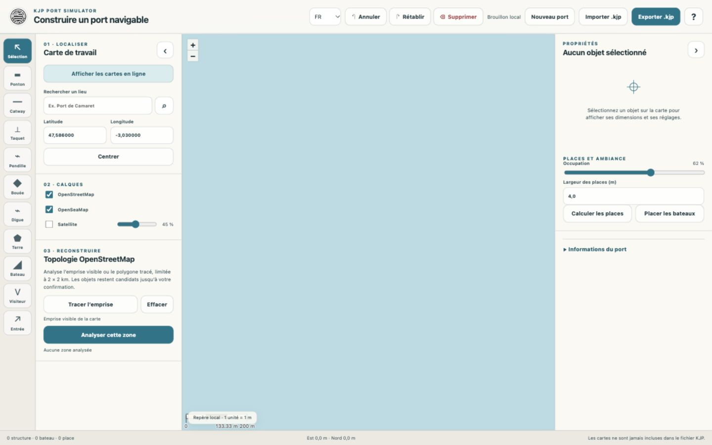

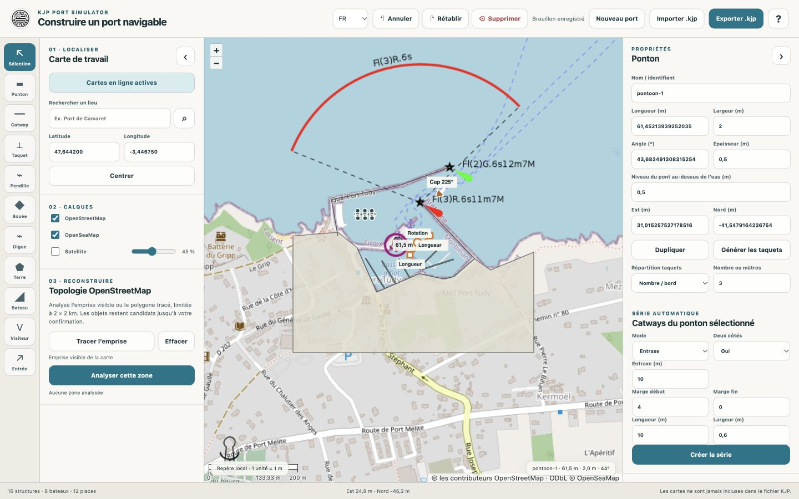

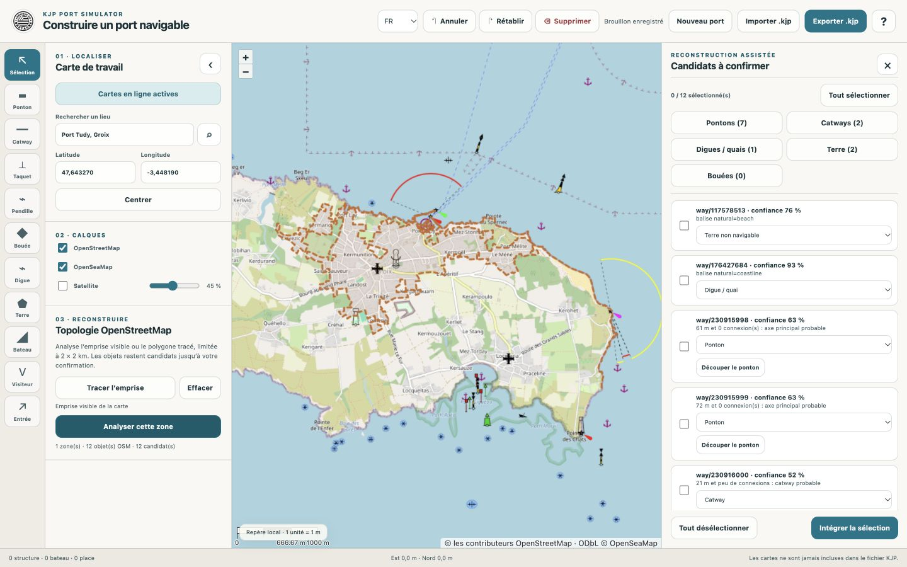

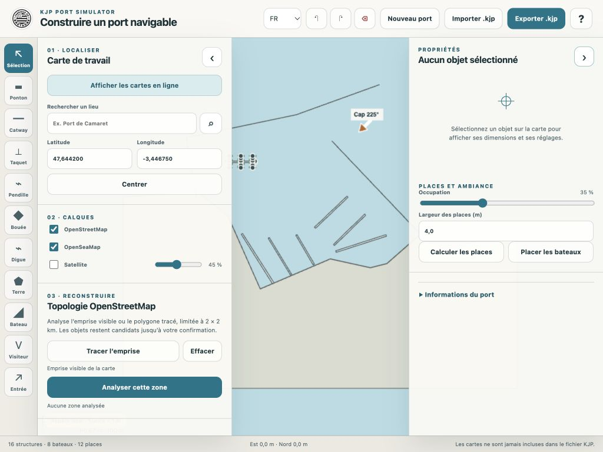

## 3. Les qualités à conserver

**La création se fait sur une carte.** L’association entre géométrie et fond de référence est la bonne base pour ce produit. Il faut renforcer ce rapport direct plutôt que faire passer toutes les opérations par des assistants.

**L’import reste soumis au choix de l’auteur.** Les candidats ne deviennent pas automatiquement des objets KJP. Les catégories, la sélection groupée et l’aperçu de découpe constituent un bon socle de contrôle humain.

**Les outils manuels et les générateurs se complètent.** L’utilisateur peut partir d’une proposition, compléter un ouvrage, créer une série ou travailler sans import. Cette liberté doit rester disponible.

**Les fondations de confiance existent déjà.** Annuler/Rétablir, brouillon automatique, validation du KJP, sélection d’un objet en erreur lorsque disponible, guide illustré et attributs d’accessibilité offrent des mécanismes utiles à mieux rendre visibles. Le toast possède déjà `role="status"` et `aria-live="polite"` : l’audit ne recommande pas de recréer ce qui existe.

**L’identité KJP est exploitable.** Le logo, les teintes marines et la tonalité pédagogique donnent une personnalité cohérente. La refonte proposée conserve ce registre et améliore la hiérarchie, les espacements et les états.

## 4. Utilisateurs et parcours à soutenir

Les trois profils suivants sont des hypothèses de travail, pas des personas issus d’entretiens.

| Profil | Intention principale | Besoin d’interface |
| --- | --- | --- |
| Contributeur occasionnel | Reconstituer un port qu’il connaît | Savoir par où commencer, ce qui est réellement créé et ce qu’il reste à vérifier. |
| Contributeur régulier | Corriger et enrichir rapidement un fichier | Accès direct aux objets, séries, valeurs numériques, raccourcis et historique. |
| Utilisateur sur tablette | Construire ou corriger en paysage | Cibles confortables, actions explicites, un panneau à la fois, contexte cartographique préservé. |

Le guide décrit onze étapes. Leur regroupement proposé réduit les changements de contexte sans supprimer d’opération :

| Parcours du guide | Espace proposé | Prochaine action rendue visible |
| --- | --- | --- |
| Préparer l’écran ; localiser ; choisir les fonds | Localiser | Chercher un port ou ouvrir un KJP ; activer les fonds avec une explication claire. |
| Délimiter ; analyser ; trier les candidats | Localiser | Examiner les propositions puis intégrer un nombre explicite d’objets. |
| Dessiner terre, digues, pontons et équipements | Construire | Ajouter un ouvrage ; modifier l’objet sélectionné. |
| Créer et modifier les séries | Construire | Prévisualiser et mettre à jour une série identifiée. |
| Places, visiteurs, bateaux et atelier pendilles | Préparer | Distinguer création des places, réservation visiteurs et peuplement. |
| Placer et orienter l’entrée | Préparer | Positionner le départ puis contrôler son cap. |
| Métadonnées, export et contrôle final | Vérifier | Corriger les erreurs, télécharger le KJP et suivre le contrôle dans le simulateur. |

Les étapes restent des espaces de travail accessibles à tout moment. Elles ne deviennent pas un tunnel obligatoire. Un utilisateur peut dessiner manuellement dès le démarrage, revenir aux fonds ou exporter une version intermédiaire dès que le format l’autorise.

## 5. Diagnostic détaillé et évolutions

### F01 — Le premier écran présente trop de fonctions avant la première décision

**Preuve : O, D · Sévérité : moyenne · Priorité : P1.** L’écran vide montre onze outils, deux panneaux, les coordonnées, les calques, l’analyse et le peuplement. « Aucun objet sélectionné » utilise une partie importante du panneau droit sans aider à démarrer. Le titre décrit la mission générale, pas le projet ouvert.

**Évolution :** un accueil de travail proposant une recherche de lieu comme action principale, puis « Ouvrir un fichier KJP » et « Dessiner sans fond ». Si un brouillon existe, proposer sa reprise avec le nom du port et expliquer son stockage local. Les commandes avancées apparaissent après le choix initial. Conserver une sortie immédiate vers l’éditeur.

**Apport :** une première décision compréhensible et un chemin de reprise visible. **Critère de réussite :** un nouvel utilisateur choisit son point de départ sans ouvrir le guide. **Maquette : A.**

### F02 — Deux panneaux permanents réduisent le contexte spatial

**Preuve : O, C · Sévérité : forte · Priorité : P1.** La carte ne dispose que de 754 px sur 1 440 ; les candidats la réduisent encore. Le panneau de localisation reste ouvert pendant l’édition, alors que l’attention porte sur un ouvrage.

**Évolution :** un rail de 64 px et un seul panneau contextuel. En édition, panneau droit de 320 px ; en revue OSM, 360 px. Les fonds, la recherche et la liste d’objets s’ouvrent à la demande. Une commande nommée « Vue d’ensemble » remplace la recherche implicite d’un cadrage.

**Apport :** dans la composition proposée, la carte dispose de 1 056 px en édition à 1 440 px de fenêtre, soit 73,3 % de la largeur et environ 40 % de largeur de plus que l’état initial à deux panneaux. Ce calcul porte sur la largeur du canevas, pas sur une surface entièrement libre d’overlays. **Critère :** sélectionner, modifier et contrôler un ouvrage sans gérer manuellement deux panneaux. **Maquettes : D, H.**

### F03 — La petite typographie donne une impression d’outil comprimé

**Preuve : O, C · Sévérité : forte · Priorité : P1.** Les outils sont étiquetés à 8 px, les champs à 9 px. Des majuscules espacées et plusieurs petits niveaux de texte multiplient les signaux sans créer une hiérarchie nette. Les glyphes Ponton/Catway et Pendille/Digue sont peu distinctifs.

**Évolution :** texte courant de 14 px, labels de 12–13 px, valeurs de 14–16 px et titres de panneau de 18–20 px. Employer une famille d’icônes de même épaisseur avec des libellés visibles pour les fonctions importantes. Réserver les petites capitales aux quelques repères de section. Remplacer les bordures et arrondis systématiques par des regroupements et séparateurs plus sobres.

**Apport :** lecture plus rapide, moins de fatigue et perception de finition plus stable. Les tailles proposées sont des choix de design, pas un minimum typographique prescrit par WCAG. **Critère :** retrouver un outil et lire une valeur à la distance habituelle de travail, à 100 % et avec agrandissement. **Toutes les maquettes.**

### F04 — Fonds, propositions et objets KJP restent trop proches dans la lecture

**Preuve : O, D · Sévérité : forte · Priorité : P1.** Le guide doit rappeler plusieurs fois qu’un objet visible n’existe pas nécessairement dans le fichier. Les photographies ajoutent un quatrième niveau : les bateaux photographiés ne sont pas des bateaux KJP.

**Évolution :** un contrôle de couches séparant « Fonds de référence », « Propositions OSM » et « Objets du port ». Utiliser fond atténué, propositions en pointillés et objets intégrés en traits pleins. Ajouter une légende courte et une commande « Voir seulement le port ». Sur une sélection, afficher son origine lorsqu’elle est disponible.

**Apport :** l’utilisateur sait ce qu’il exportera et ce qui sert seulement de référence. La différenciation par trait, texte et état reste lisible sans dépendre uniquement des couleurs. **Critère :** distinguer les trois catégories et retrouver le nombre d’objets effectivement intégrés. **Maquettes : B, C, D.**

### F05 — La revue OSM est présentée avec le vocabulaire de la donnée

**Preuve : O, D, C · Sévérité : forte · Priorité : P1.** Les lignes commencent par `way/…` et un pourcentage de confiance. Les boutons de catégorie sélectionnent des objets, alors que leur présentation peut évoquer des filtres. Modifier une catégorie coche aussi le candidat : deux décisions sont couplées.

**Évolution :** commencer par « Ponton 01 », sa dimension et son statut. Placer l’identifiant source et l’explication de classification dans les détails. Séparer clairement **Filtrer** de **Inclure** ; changer la catégorie ne doit pas changer silencieusement l’inclusion. Afficher « 6 objets retenus » et « Intégrer 6 objets ». Conserver l’explication de confiance en précisant qu’elle porte sur la classification, sans la remplacer par une promesse de fiabilité.

**Apport :** décisions plus explicites et moins de risque d’intégration involontaire. **Critère :** comparer, recatégoriser et exclure un candidat sans modifier les autres choix. **Maquette : C.**

### F06 — Les résultats d’analyse peuvent faire perdre le cadrage

**Preuve : O, D, C · Sévérité : forte · Priorité : P1.** La vue réelle a dézoomé à l’échelle d’une grande partie de l’île. Le code cadre l’étendue des candidats. Le polygone d’analyse sélectionne des géométries sans nécessairement les découper.

**Évolution :** conserver le cadrage et l’emprise de départ à l’arrivée des résultats. Signaler « Cette géométrie dépasse la zone analysée ». Proposer « Voir l’objet entier », « Revenir à la zone » et « Vue précédente » comme décisions explicites. Ne pas tronquer les données pour corriger un problème de caméra.

**Apport :** la revue commence là où l’utilisateur travaillait. **Critère :** une côte très étendue ne fait plus perdre la position du port ; son extension reste inspectable. **Maquettes : B, C.**

### F07 — L’attente OSM expose surtout le mécanisme technique

**Preuve : O, D, C · Sévérité : moyenne · Priorité : P1.** Les tentatives et serveurs sont visibles, ce qui vaut mieux qu’une attente muette. Leur formulation aide cependant davantage au diagnostic technique qu’à la décision de l’utilisateur. La demande peut durer jusqu’à trois minutes.

**Évolution :** afficher un état persistant « Recherche des ouvrages… », la durée écoulée, l’information « Le service est occupé ; nouvelle tentative automatique » et les choix de retour au dessin. Garder le serveur et les tentatives dans « Détails ». Une vraie commande Annuler suppose l’interruption de la requête et la protection contre une réponse tardive ; elle ne doit pas être une simple fermeture visuelle. Ne pas afficher de pourcentage de progression inventé.

**Apport :** l’utilisateur comprend s’il faut attendre et peut reprendre le contrôle. **Critère :** un échec indique ce qui a été conservé, comment réessayer et comment continuer. **Maquette : B, état d’attente.**

### F08 — Sélectionner un objet et déplacer la carte peuvent entrer en conflit

**Preuve : O, D, C · Sévérité : forte · Priorité : P1.** Le guide demande de viser une zone libre pour déplacer la carte et l’intérieur d’une place pour éviter les taquets. La sélection d’objets superposés est difficile à faible zoom.

**Évolution :** ajouter un outil clairement nommé « Déplacer la vue », un filtre de sélection par type et une liste d’objets synchronisée avec la carte. Lorsqu’un clic rencontre plusieurs objets, présenter une petite liste « Place / Catway / Ponton » avec surbrillance de prévisualisation. Préserver l’accès direct aux dimensions pour corriger sans glisser.

**Apport :** moins de déplacements involontaires et une sélection maîtrisée dans les zones denses. Les raccourcis sont un complément, pas l’unique accès. **Critère :** sélectionner le ponton parent sous une place et déplacer la vue sans modifier le port. **Maquettes : D, F.**

### F09 — L’inspecteur mélange réglages d’objet et opérations sur le projet

**Preuve : O, C · Sévérité : forte · Priorité : P1.** Le ponton sélectionné fait apparaître géométrie, taquets, catways, pendilles, peuplement et métadonnées dans la même colonne. L’absence de nom de projet visible et l’emplacement des métadonnées en bas brouillent encore les niveaux.

**Évolution :** réserver l’inspecteur à l’objet, avec trois sections : « Dimensions », « Équipements », « Avancé ». Déplacer le peuplement dans Préparer, et les informations générales dans le menu du projet et Vérifier. Afficher uniquement les propriétés applicables ; les données dérivées deviennent des informations, avec une explication si leur modification est indisponible.

**Apport :** l’utilisateur comprend la portée de son action et retrouve les réglages fréquents sans défilement long. **Critère :** les dimensions et les équipements d’un ponton sont accessibles dans le premier panneau ; l’entrée ne présente plus de champs de longueur vides. **Maquette : D.**

### F10 — Les nombres affichent une précision inutile ; la validation est implicite

**Preuve : O, D, C · Sévérité : moyenne · Priorité : P1.** Les valeurs brutes comportent de nombreuses décimales ; le guide explique que la modification s’applique en quittant le champ.

**Évolution :** formater l’affichage selon l’usage : dimensions courantes au décimètre, angles à une précision pertinente, coordonnées dans Avancé. Conserver la valeur interne tant que l’utilisateur n’édite pas le champ. Une simple sélection ou perte de focus ne doit pas arrondir la géométrie. Permettre Entrée pour appliquer et Échap pour abandonner une saisie ; afficher un retour bref « Dimensions mises à jour ».

**Apport :** lecture plus claire et certitude sur l’application d’une saisie. **Critère :** sélectionner puis désélectionner un ponton importé conserve exactement ses données ; seule une modification explicite les change. **Maquette : D.**

### F11 — Modifier une série demande un détour et peut créer des doublons

**Preuve : D, C · Sévérité : forte · Priorité : P1.** Le guide décrit la préparation des valeurs sur le ponton, puis la sélection d’un catway pour modifier sa série. « Créer la série » ajoute une nouvelle série ; le bouton ne remplace pas celle qui existe.

**Évolution :** faire de la série une sélection de travail identifiable depuis le ponton et ses membres. Charger ses paramètres existants dans un panneau dédié. Afficher « 3 par côté × 2 côtés = 6 catways » et une prévisualisation temporaire. Pour une série existante, l’action principale devient « Mettre à jour la série ». « Créer une autre série » reste une action distincte. Le détachement conserve une explication de ses conséquences.

**Apport :** une édition cohérente avec le modèle mental « je modifie ce groupe ». **Critère :** passer de trois à quatre catways par côté modifie le groupe choisi sans ajouter un second groupe ; Annuler restaure le groupe et ses associations. La gestion des enfants et places nécessite une vérification fonctionnelle ciblée lors de l’implémentation. **Maquette : E.**

### F12 — Calcul des places et peuplement ont une portée insuffisamment annoncée

**Preuve : O, D, C · Sévérité : forte · Priorité : P1.** « Placer les bateaux » régénère le peuplement. Un recalcul des places peut retirer celles créées autrement. Le guide recommande un ordre d’opérations pour préserver l’atelier pendilles et les visiteurs.

**Évolution :** séparer « Places » et « Bateaux de décor ». Nommer l’action « Régénérer le peuplement ». Avant une reconstruction, annoncer les catégories affectées et les conséquences vérifiables. Ne promettre la conservation des places manuelles ou visiteurs que si l’algorithme la garantit ; autrement, proposer une sauvegarde et une validation explicite. Les actions ordinaires réversibles restent rapides.

**Apport :** les boutons cessent de surprendre par leur portée. **Critère :** avant de confirmer, l’utilisateur sait s’il reconstruit des places ou seulement le décor ; une annulation restaure les données concernées. **Maquette : F.**

### F13 — Le dessin manque d’instructions à l’endroit du geste

**Preuve : D, C · Sévérité : moyenne · Priorité : P2.** Digue, terre, emprise et entrée ne se terminent pas de la même manière. L’entrée demande un glissement orienté ; terminer un dessin peut aussi modifier le zoom selon le geste.

**Évolution :** une aide compacte sur la carte, propre à l’outil actif : « Cliquez pour ajouter un sommet », « Fermez sur le premier point », « Terminer », « Annuler le tracé ». Pour l’entrée, proposer aussi deux actions simples « Placer le départ » puis « Définir le cap » et la saisie numérique. Tester le double-clic et les gestes de zoom pour éviter un changement de vue parasite. L’édition de sommets serait une évolution fonctionnelle distincte, pas une simple retouche visuelle.

**Apport :** l’apprentissage se fait dans l’action ; le guide devient une aide approfondie. **Critère :** achever un polygone et orienter une entrée sans connaître un geste caché. **Maquettes : B, D et état Entrée.**

### F14 — Deux conventions d’angle méritent un repère visuel constant

**Preuve : D, C · Sévérité : moyenne · Priorité : P1 pour les labels.** L’angle du ponton et le cap de l’entrée n’ont pas le même zéro ni le même sens de lecture.

**Évolution :** conserver les conventions et données existantes, avec « Angle du plan — 0° Est, 90° Nord » pour la géométrie et « Cap nautique — 0° Nord, 90° Est » pour l’entrée. Ajouter une petite rose adaptée à la convention du champ. Ne pas appliquer une conversion globale pour rendre les libellés uniformes.

**Apport :** l’utilisateur interprète la valeur avant de la modifier. **Critère :** les deux champs expliquent leur convention et produisent la même orientation qu’avant refonte à valeur équivalente. **Maquettes : D, état Entrée.**

### F15 — Le brouillon local, le projet ouvert et le fichier exporté sont mal différenciés

**Preuve : O, D, C · Sévérité : forte · Priorité : P1.** Le nom du port n’est pas dans l’en-tête ; la sauvegarde disparaît sur tablette. Le brouillon est utile mais limité au navigateur. L’import remplace le document courant et son historique ; le code ne présente pas le même avertissement que « Nouveau port » avant le remplacement.

**Évolution :** afficher le nom du projet et un état de brouillon explicite dans le bandeau. Distinguer « Brouillon enregistré sur cet appareil » de « Dernier export ». Prévenir avant un remplacement si des changements depuis l’export doivent être conservés, avec « Exporter puis ouvrir » / « Remplacer » / « Annuler ». Prévoir un état « Stockage indisponible : exportez pour conserver votre travail ». Une date d’export suppose de mémoriser cet événement ; elle ne doit pas être déduite de l’autosauvegarde.

**Apport :** un sentiment de maîtrise fondé sur l’état réel de la sauvegarde. **Critère :** le statut reste accessible sur tablette, et l’ouverture d’un autre KJP explicite le remplacement. **Maquettes : A, D, G.**

### F16 — La validation est tardive et ses erreurs sont trop techniques

**Preuve : O, D, C · Sévérité : forte · Priorité : P1.** L’export valide déjà le fichier, mais n’affiche que le premier diagnostic dans un message temporaire. L’absence d’entrée observée ne propose pas d’action corrective. Certains objets disposent déjà d’un bouton « Afficher l’objet », à conserver.

**Évolution :** un panneau Vérifier persistant, basé sur les diagnostics existants : erreurs bloquantes, conseils et contrôles manuels sont séparés et nommés. Traduire les chemins techniques en messages orientés tâche : « Placez le point d’entrée du bateau » avec un bouton « Placer l’entrée ». Garder le détail technique dépliable. Afficher la liste complète et sélectionner le champ ou l’objet concerné.

**Apport :** corriger devient une suite d’actions, sans mémoriser un toast. La validation du format ne doit jamais devenir un badge certifiant la fidélité d’un port ou la qualité d’un passage. **Critère :** corriger deux erreurs successives sans relancer l’export entre chaque diagnostic ; les contrôles visuels restent présentés comme manuels. **Maquette : G.**

### F17 — L’adaptation tablette demande encore une gestion de fenêtres

**Preuve : O, D, C · Sévérité : forte · Priorité : P1.** L’ouverture du panneau droit conserve le panneau gauche ; la carte visible descend à 300 px de large. Les flèches ne décrivent pas le contenu qu’elles ouvrent et l’état de sauvegarde est masqué.

**Évolution :** un seul panneau contextuel ouvert à la fois, commandes nommées « Objets », « Propriétés », « Fonds », et accès direct à une grande carte. Champs et actions fréquentes d’au moins 44 px de haut comme cible de confort tactile. Maintenir un indicateur de sauvegarde accessible dans l’en-tête. Éviter les panneaux bas permanents qui prendraient trop de hauteur en paysage.

**Apport :** moins d’occlusion et une navigation prévisible au doigt. Avec rail 64 px et panneau 320 px, la maquette conserve 640 px de carte à 1 024 px de fenêtre ; panneau fermé, 960 px. **Critère :** ouvrir les propriétés ferme le panneau de localisation ; les actions de validation restent visibles lors d’une saisie avec clavier virtuel. Ce dernier point reste à tester sur matériel réel. **Maquette : H.**

### F18 — Le passage au simulateur et l’aide peuvent être mieux accompagnés

**Preuve : O pour l’aide, D pour le parcours final · Sévérité : moyenne · Priorité : P2.** L’aide est complète, mais ressemble à un long document dans une fenêtre modale. Vérifier le port implique ensuite de télécharger un KJP, ouvrir le simulateur et le recharger.

**Évolution :** conserver le guide, ajouter une aide reliée à la tâche et un sommaire. Après export, montrer les étapes de chargement dans le simulateur et les points de contrôle du guide. Le premier lot peut simplement ouvrir le simulateur et expliquer le chargement. Un transfert direct vers le simulateur exige un protocole de document validé et une gestion des erreurs : c’est un chantier ultérieur.

**Apport :** une continuité entre « j’ai exporté » et « j’ai essayé mon port ». **Critère :** une personne retrouve son port et sa place visiteurs dans le simulateur sans rechercher la procédure. **Maquette : G, état après export.**

## 6. Direction visuelle et règles d’interface

La direction proposée conserve une identité marine calme : encre sombre, surfaces claires, eau désaturée et accent turquoise foncé. La carte porte l’information spatiale ; les panneaux offrent une lecture nette. Les ombres servent aux surfaces superposées ; les cartes décoratives et dégradés ne deviennent pas le langage général de l’éditeur.

| Élément | Proposition | Rôle |
| --- | --- | --- |
| Encre principale | `#17363b` | Titres, valeurs et texte prioritaire. |
| Texte secondaire | `#526b70` | Labels et explications encore lisibles. |
| Accent action | `#0b6668` | Action principale, sélection et état actif. |
| Surface de travail | `#f7f9f7` et blanc | Panneaux opaques ; la carte reste visible autour. |
| Avertissement | Fond ambre pâle, texte brun foncé, icône et phrase | Attirer l’attention sur une conséquence sans évoquer une erreur bloquante. |
| Erreur | Texte `#af4138`, message et action | Identifier et corriger une anomalie. |
| Objets / candidats | Trait plein / trait pointillé avec légende | Comprendre le statut sans dépendre de la teinte. |
| Rythme | Espacements de 4, 8, 12, 16, 24 et 32 px ; rayons de 8 à 12 px | Regrouper les contrôles sans tout enfermer dans des cartes. |
| Densité | Champs de 40–44 px ; actions tactiles de 44 px | Concilier précision au pointeur et usage tablette. |

Les contrastes calculés des tokens sur blanc sont de **12,91:1** pour l’encre, **5,68:1** pour le texte secondaire et **6,74:1** pour l’accent. Ils portent sur ces paires de couleurs opaques, pas sur toutes les combinaisons de la maquette ni sur une qualification d’accessibilité du produit.

Les conventions d’écriture restent concrètes : un verbe et un objet (« Intégrer 6 objets », « Mettre à jour la série »), un résultat quand il est connu, et une conséquence avant une reconstruction. « Topologie OpenStreetMap » peut devenir « Importer des ouvrages depuis OpenStreetMap ». « Nom / identifiant » devient un titre d’objet lisible avec identifiant secondaire. « Nombre ou mètres » devient soit « Taquets par bord », soit « Espacement entre taquets », selon le mode.

## 7. Les maquettes et ce qu’elles permettent de juger

Ouvrir **`maquettes.html`** pour parcourir les états. Les interactions sont illustratives : changement d’écran, sélection d’objet, filtres OSM, réglage d’une série, réglage d’occupation, correction de l’entrée et simulation d’export. Elles ne constituent pas un second générateur et ne calculent aucun port réel. Les formes du port proviennent du fichier pédagogique du guide ; les états et libellés futurs servent à évaluer le design. Les chiffres illustratifs ne décrivent pas l’occupation réelle de Port Tudy.

### A — Un démarrage orienté vers le projet

Recherche du lieu au premier plan, ouverture d’un fichier et dessin libre accessibles, brouillon identifiable. Cette vue permet de juger si la première décision devient évidente sans imposer un tutoriel.

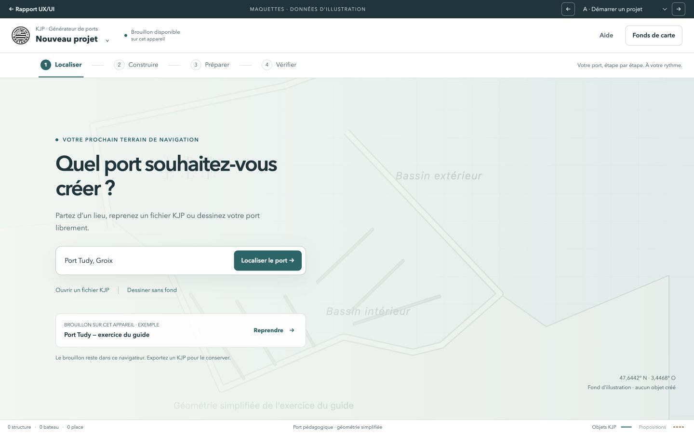

### B — Une importation située et une attente compréhensible

Emprise conservée, dimensions de la zone visibles, aide au tracé et états d’attente persistants. La vue permet de vérifier la relation entre le périmètre analysé, le fond et le résultat attendu. Les détails des serveurs restent secondaires.

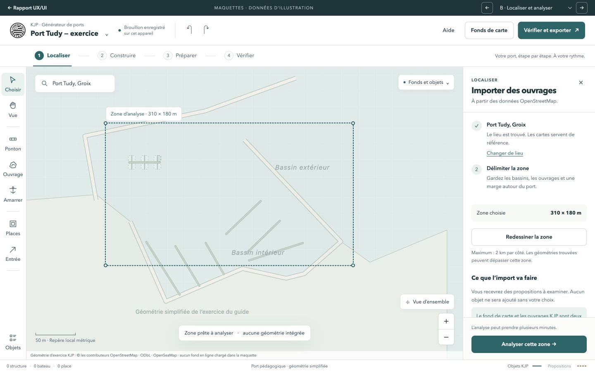

### C — Une revue OSM qui distingue voir, classer et inclure

Noms lisibles, dimensions, filtres séparés des cases d’inclusion et nombre d’objets sur le bouton. La carte garde son cadrage. L’alerte d’extension rend un grand objet inspectable sans éloigner automatiquement la vue.

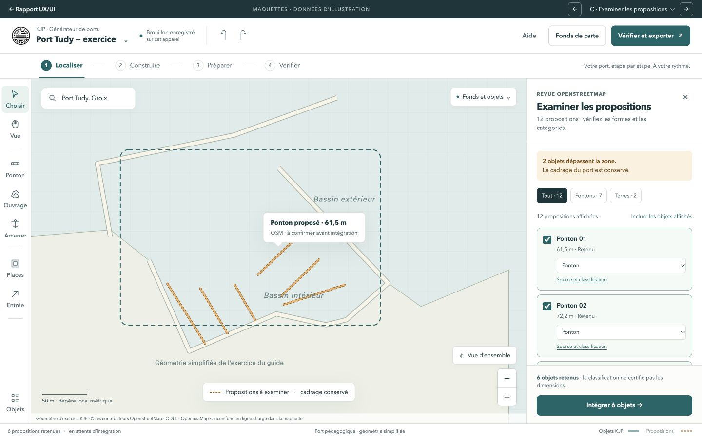

### D — Un éditeur centré sur l’objet

Grand canevas, panneau unique, dimensions arrondies à l’affichage, provenance et accès aux équipements. La liste d’objets et le déplacement de vue sont accessibles sans panneau gauche permanent. La vue est conçue pour la correction régulière autant que pour la découverte.

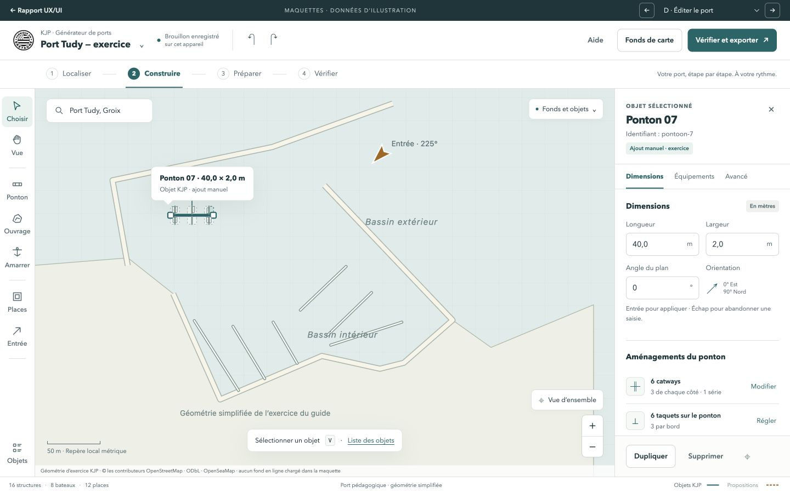

### E — Une série identifiable et modifiable au même endroit

Les paramètres chargés correspondent à la série existante. Le nombre par côté est explicite, l’aperçu est distinct du résultat engagé et le bouton annonce une mise à jour. Cette vue cible le risque de superposition de séries.

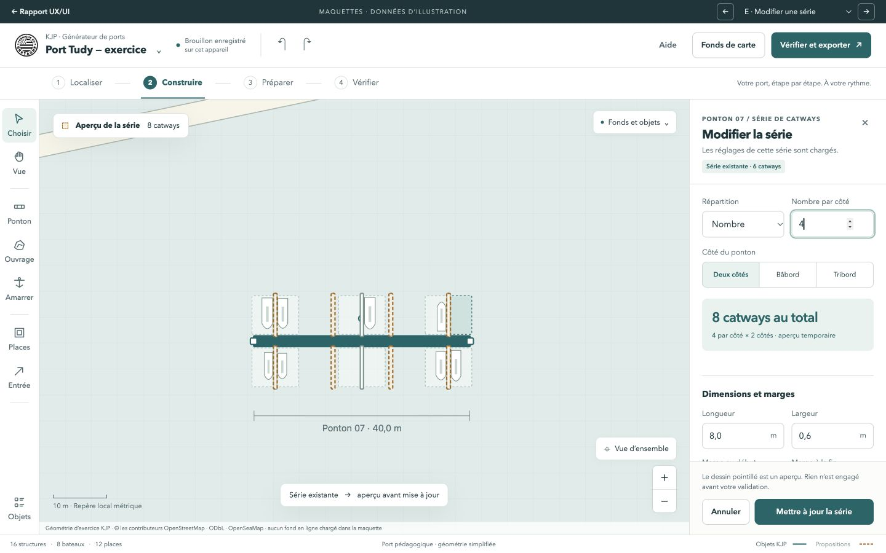

### F — Places, visiteurs et décor séparés

La liste permet de retrouver une place sans viser entre les taquets. La réservation visiteurs se lit directement. Le peuplement affiche sa consigne et son caractère régénératif ; le recalcul des places annonce sa portée.

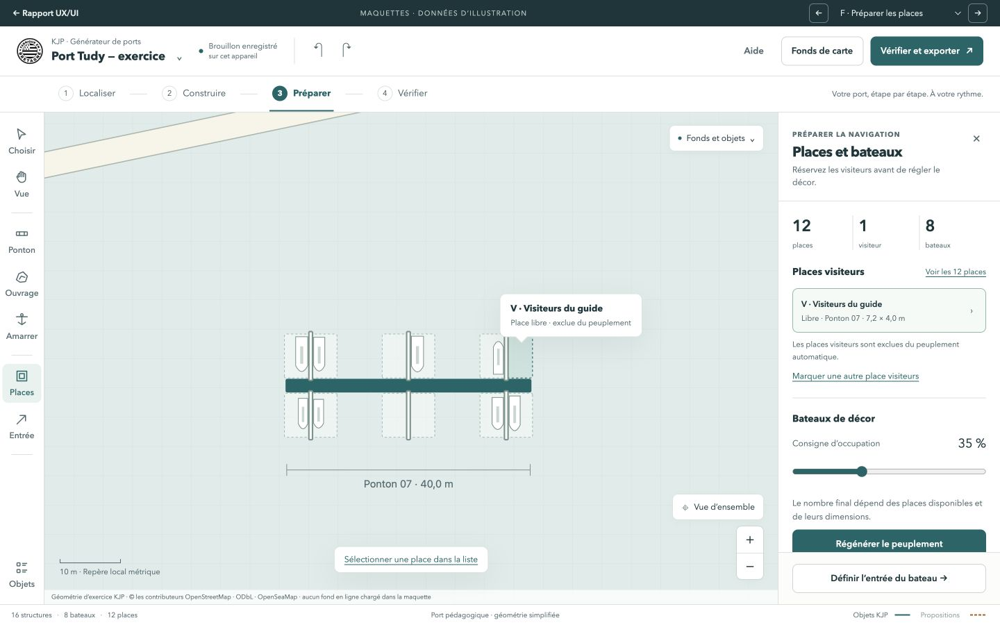

### G — Une validation qui permet de corriger

Une entrée manquante devient une action. Les contrôles automatiques du format sont distingués de la revue manuelle de la géométrie. Le téléchargement reste une action explicite ; le contrôle dans le simulateur est la suite du parcours.

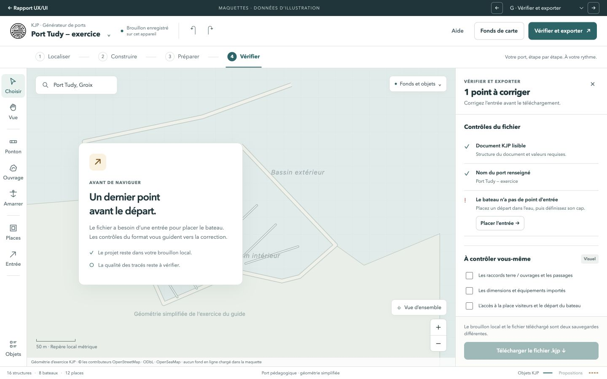

### H — Le même atelier en tablette paysage

Un seul panneau de propriétés, outils regroupés, état du brouillon maintenu et grandes cibles. Cette déclinaison montre la priorité donnée au canevas, sans tenter de comprimer simultanément les deux panneaux de l’ordinateur.

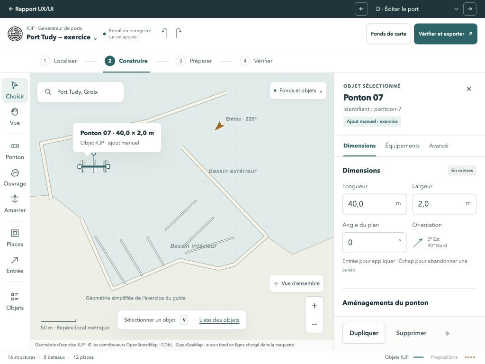

## 8. Accessibilité et robustesse des interactions

L’objectif proposé est WCAG 2.2 AA pour les interfaces et parcours couverts. L’audit actuel ne constitue pas une certification. La carte et ses opérations demandent une vérification spécifique, au-delà du contraste des panneaux.

Les textes ordinaires doivent atteindre un contraste d’au moins 4,5:1, avec les exceptions prévues par le critère. Le minimum de cible de WCAG 2.2 est de 24 × 24 pixels CSS, sous réserve de ses exceptions ; les 44 px proposés ici sont une cible de confort tactile, pas la traduction de ce minimum. Voir [Contraste minimal](https://www.w3.org/WAI/WCAG22/Understanding/contrast-minimum.html) et [Taille des cibles](https://www.w3.org/WAI/WCAG22/Understanding/target-size-minimum).

Conserver les labels explicites, compléter l’état actif des outils par `aria-pressed`, présenter un focus visible et restaurer le focus après fermeture d’un panneau. Donner aux menus, onglets et listes d’objets un comportement clavier cohérent. L’aide à la saisie ne doit pas disparaître au survol. Les états successifs d’import, sauvegarde et validation doivent être annoncés sans déplacer inutilement le focus ; le mécanisme existant de messages de statut est à conserver et à compléter. Voir [Messages de statut](https://www.w3.org/WAI/WCAG22/Understanding/status-messages.html).

Prévoir un équivalent utilisable sans glissement pour déplacer et orienter les objets : champs numériques, actions par étapes ou commandes adaptées. Les besoins exacts de chaque opération cartographique doivent être examinés au regard du critère et de ses exceptions ; la carte ne rend pas automatiquement tous les gestes exemptés. Voir [Mouvements de glissement](https://www.w3.org/WAI/WCAG22/Understanding/dragging-movements.html).

L’agrandissement du texte et le zoom à 200 % doivent préserver les formulaires et actions. Le canevas peut nécessiter une présentation spatiale, mais les panneaux doivent rester utilisables. Sur tablette physique, vérifier le clavier virtuel, les poignées, le zoom à deux doigts et les cibles proches. Un message d’erreur durable garde sa place même après une animation ou un changement de sélection.

La localisation FR/EN/BR est déjà en place. Les nouveaux composants doivent passer par les catalogues existants, supporter des libellés plus longs et conserver les textes d’auteur sans traduction automatique. Les maquettes sont en français ; la déclinaison des autres langues reste un travail de réalisation.

## 9. Priorités et séquence de réalisation

P1 désigne le premier ensemble à réaliser ; P2 une amélioration suivante ; P3 une extension à décider après essais. Aucun blocage général du générateur n’a été constaté. Les niveaux d’effort sont relatifs : S = local, M = plusieurs états d’interface, L = dépendances fonctionnelles. Ils ne sont pas des engagements de calendrier.

| Lot | Contenu | Priorité et effort | Dépendances | Critère de sortie |
| --- | --- | --- | --- | --- |
| 1. Confort et repères | Typographie, icônes, nom du projet, statut de brouillon, nombres formatés sans mutation, libellés d’angles, panneau unique tablette | P1 · M | Styles, template, catalogues ; logique d’affichage des nombres | Pas de perte de données à la sélection ; carte utilisable et statut accessible sur les deux formats. |
| 2. Atelier cartographique | Quatre espaces libres, inspecteur recentré, fonds à la demande, déplacement de vue, liste d’objets et sélection ambiguë | P1 · L | État UI partagé et interactions OpenLayers existantes | Retrouver un ponton sous une place ; corriger ses dimensions sans gérer plusieurs panneaux. |
| 3. Import maîtrisé | Cadrage conservé, filtres et inclusion distincts, noms de propositions, attente, extensions hors zone | P1 · M à L | Cycle de requêtes ; gestion d’une annulation si ajoutée | Le tri ne déplace pas implicitement le contexte ; une réponse tardive ne modifie pas une opération abandonnée. |
| 4. Opérations explicites | Panneau de série existante, aperçu, mises à jour ; portée des recalculs et peuplement | P1 · L | Groupes et associations du cœur éditeur | Pas de série doublée par une édition ; Annuler restaure objets, places et associations concernés. |
| 5. Vérifier et conserver | Diagnostics persistants, actions correctives, informations du port, ouverture protégée d’un autre fichier | P1 · M | Validateur KJP, événements d’export, autosauvegarde | Erreurs corrigeables depuis leur liste ; remplacement et sauvegarde compréhensibles. |
| 6. Aide dans la tâche | Sommaire du guide, aides de dessin, parcours de contrôle dans le simulateur | P2 · M | Organisation du guide et état d’outil | L’utilisateur termine le parcours avec moins de recours au document intégral. |
| 7. Extensions | Édition de sommets, historique lisible, transfert direct au simulateur, bibliothèque de projets locaux | P3 · L chacune | Modèle de document, stockage et protocole entre produits | Besoin confirmé en essais ; chantier cadré séparément. |

Les lots peuvent se chevaucher en conception, mais la réalisation doit rester incrémentale. Le lot 1 fournit un gain visible sans réorganiser d’abord toute l’application. Les prévisualisations et la mise à jour des séries ne sont pas de simples travaux CSS : elles demandent un état temporaire et un engagement atomique des modifications.

### Ce que je ne mettrais pas dans le premier périmètre

Une version téléphone complète, des comptes utilisateurs, une sauvegarde cloud, du travail collaboratif ou une refonte du rendu 3D n’ont pas de besoin démontré dans cet audit. Un mode sombre peut être étudié après stabilisation de la lisibilité, mais ne résoudra pas les problèmes de parcours. L’édition géométrique de sommets et le transfert vers le simulateur méritent des décisions propres.

## 10. Vérifier que la refonte améliore réellement l’usage

Organiser une première série d’essais modérés avec des contributeurs occasionnels et réguliers, incluant des personnes sur tablette. Un groupe de cinq à huit personnes est une proposition de départ pour recueillir des problèmes qualitatifs, pas un échantillon permettant de mesurer un taux de succès fiable à grande échelle.

| Tâche d’essai | Observation utile | Résultat attendu, à confirmer |
| --- | --- | --- |
| Créer un nouveau port depuis un lieu | Hésitations initiales, besoin du guide | L’utilisateur identifie son premier geste et comprend l’activation des fonds. |
| Inclure six pontons en excluant une grande terre | Erreurs de sélection, compréhension du statut | Aucun objet non voulu intégré ; la zone de travail reste identifiable. |
| Corriger un ponton au milieu de places | Tentatives de sélection, déplacements involontaires | Le parent est accessible par la carte ou la liste ; le fond se déplace sans déplacer l’ouvrage. |
| Modifier une série existante | Groupes créés, actions Annuler | La série change sans doublon ; le retour arrière restaure son état. |
| Réserver une place et refaire le décor | Interprétation de l’occupation et du recalcul | La personne distingue places, visiteurs et bateaux de décor et anticipe l’effet de l’action. |
| Exporter un document sans entrée | Temps pour comprendre et corriger | L’entrée est placée depuis le diagnostic, puis le fichier téléchargé. |
| Ouvrir un autre fichier après modification | Compréhension du remplacement | La décision de conserver ou remplacer est informée. |
| Reprendre sur tablette | Panneaux ouverts, lisibilité, clavier et gestes | Un seul panneau occulte la carte ; les champs et actions restent utilisables. |

Mesurer les réussites sans assistance, les erreurs, le nombre de tentatives de sélection, les opérations annulées et le temps par tâche. Recueillir une note de facilité après chaque tâche. Comparer l’existant et la proposition avec un ordre alterné pour limiter l’effet d’apprentissage. Établir d’abord les valeurs de référence ; ne pas annoncer un gain de 30 % ou un score d’ergonomie sans cette mesure.

À la réalisation, exécuter `npm run check:generator`, ouvrir l’interface et contrôler la console, puis les cas `validate:ui` du générateur correspondant aux interactions modifiées. Une modification de série ou de conservation des places nécessite aussi les vérifications fonctionnelles ciblées du cœur éditeur. Une qualification complète de release n’est pas nécessaire pour chaque lot visuel.

## 11. Références et traçabilité

### Sources internes principales

- [Guide utilisateur français](../../guide-generateur.fr.md), notamment étapes 1 à 4 pour les panneaux et l’import, 5 à 7 pour les séries et places, 8 pour l’entrée, 9 à 11 pour les informations et l’export.
- [Template du générateur](../../../src/generateur-port/template.html) : organisation des commandes, panneaux, formulaires et aide.
- [Styles](../../../src/generateur-port/styles.css) : tailles typographiques, grille, panneaux et adaptation aux fenêtres étroites.
- [Comportements du générateur](../../../src/generateur-port/main.js) : `updateInspector`, `showCandidateDrawer`, `analyzeVisibleZone`, gestionnaires de séries et peuplement, export/import et panneaux.
- [Cœur éditeur](../../../src/ports/port-editor-core.js) : groupes, recalcul des places et peuplement ; consulté de manière ciblée.
- [Port pédagogique du guide](../../exemples/port-tudy-exercice.kjp) : projet manipulé et géométries utilisées dans les maquettes.

Les relations de fichiers ont été repérées avec `graphify query`, puis vérifiées dans les sources. Les captures `actuel-*.jpg` documentent les observations locales. Les `maquette-*.jpg` sont des propositions et ne doivent pas être présentées comme des captures d’une version réalisée.

### Références externes de méthode

Les principes de visibilité de l’état, contrôle utilisateur, reconnaissance et prévention des erreurs soutiennent les recommandations de parcours ; ils n’en démontrent pas à eux seuls l’efficacité dans KJP. Références primaires : [Nielsen Norman Group — heuristiques d’utilisabilité](https://www.nngroup.com/articles/ten-usability-heuristics/) et [reconnaissance et rappel](https://www.nngroup.com/articles/recognition-and-recall/), consultées le 17 octobre 2026.

Les documents W3C cités dans la section accessibilité précisent les exigences concernées. Ils servent de cadre, pas de résultat d’audit automatisé. Aucune nouvelle source externe nautique ou physique n’a été utilisée ; cet audit d’interface ne nécessite pas d’ajout à la bibliographie nautique du projet. Les crédits OpenStreetMap/OpenSeaMap restent présents pour les géométries internes et captures qui les utilisent.

### Livrables

- `index.html` : lecture du rapport, accès aux captures et aux maquettes.
- `rapport.md` : source éditable de cette analyse.
- `maquettes.html` : prototype de présentation indépendant du générateur.
- `maquettes.css`, `maquettes.js`, `assets/port-exercice.svg` : sources de la proposition visuelle.
- `assets/actuel-*.jpg` : captures de l’existant ; `assets/maquette-*.jpg` : propositions visuelles.

**Contrôles des livrables :** syntaxe de `maquettes.js`, présence des ressources et des ancres du rapport, revue visuelle des huit vues, sélection OSM avec mise à jour du compteur, passage de trois à quatre catways par côté dans l’aperçu, correction de l’entrée et activation de l’export simulé. La console des maquettes et celle du rapport ne remontent pas d’erreur. Le rapport a également été contrôlé à 390 px de largeur, sans débordement horizontal de la page. Le graphe local a été mis à jour par `graphify update .` sans appel LLM.

Le résultat recommandé est un outil qui garde sa capacité de modélisation, tout en rendant visibles le projet ouvert, l’objet manipulé, la portée d’une action et le chemin vers un fichier utilisable.
